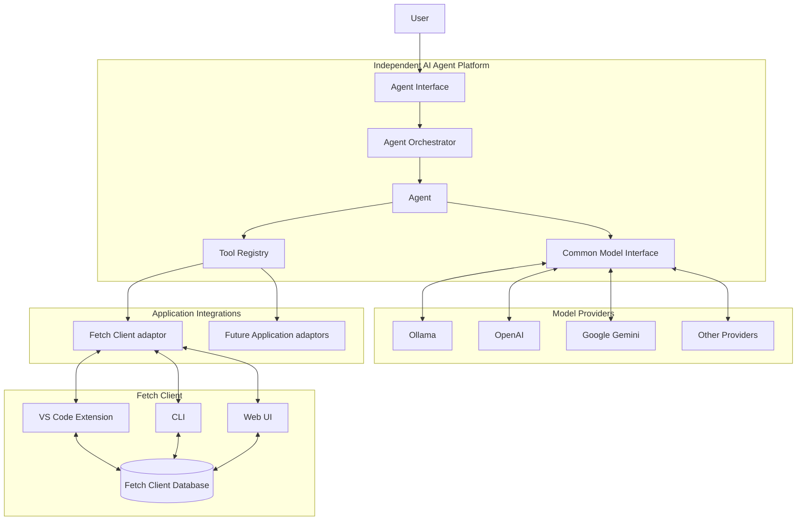
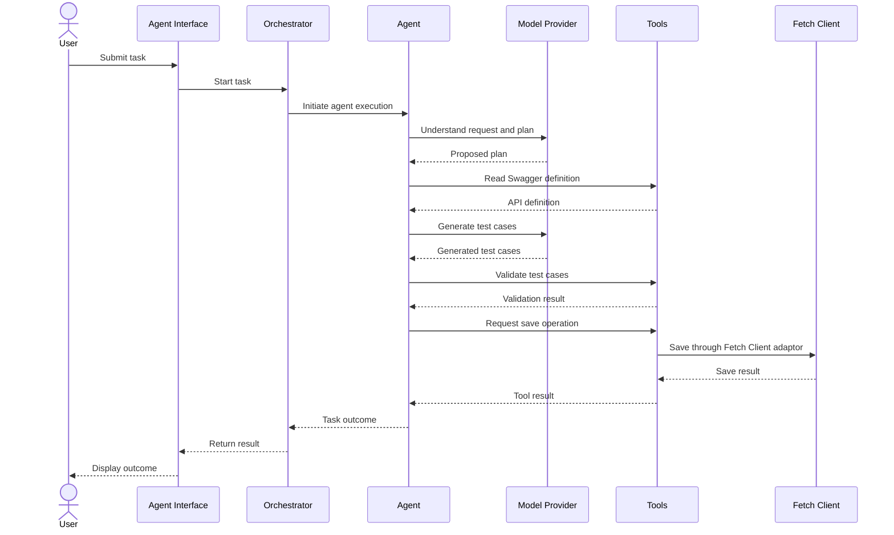

# Day 3 — Conceptual Architecture of the AI Agent Platform

**Phase:** 0 — Product goal and preparation **Session:** Day 3 **Primary deliverable:** `docs/ai-agent/02-architecture/conceptual-architecture.md` **Related follow-up:** `docs/ai-agent/01-foundations/llm-basics.md`

## 1. Purpose

This document defines the conceptual architecture of the AI Agent Platform.

The goal is to build an independent, extensible platform that can use different language-model providers and integrate with different applications. Fetch Client will be the first application integration, but the platform must not depend on Fetch
Client to operate.

This is a conceptual design. Detailed component design, security architecture, data-flow design, technology selection, and deployment decisions are intentionally deferred to later sessions.

## 2. Learning objectives

By the end of this session, you should be able to explain:

- The difference between a model, an agent, an orchestrator, and a tool.
- The boundaries between the agent platform, model providers, and application integrations.
- How an agent task moves from a user request to a completed result.
- Why application adaptors and provider interfaces help keep the platform extensible.

## 3. Core concepts

### 3.1 Model (LLM)

A Large Language Model (LLM) provides language understanding, reasoning, and content-generation capabilities.

Examples include models from Qwen, Llama, GPT, and Gemini families.

An application generally communicates with a hosted model or a local model runtime through an API. A typical request contains:

- The selected model identifier.
- Messages or instructions, often with roles such as `system`, `user`, and `assistant`.
- Optional generation settings.
- Optional tool definitions or structured-output requirements.

A response typically contains generated content and may also include metadata such as completion status, token usage, finish reason, or tool-call information. Exact request and response formats vary by provider.

The platform should hide provider-specific differences behind a common model-provider interface. Provider-specific adaptors translate the platform's common request into the provider's API format and normalise the response.

**Related learning document:** `docs/ai-agent/01-foundations/llm-basics.md` should contain the detailed exploration of LLM APIs, providers, request/response structures, tokens, and context windows.

### 3.2 Agent

An agent is an execution unit that uses a model, instructions, context, and available tools to pursue a goal.

Typical responsibilities include:

- Understanding the user's objective.
- Determining or following an execution plan.
- Deciding when a tool is needed.
- Interpreting tool results.
- Continuing, revising, or ending the task.
- Producing a result for the user.

An agent is not simply the model. The model provides language and reasoning capabilities; the surrounding agent logic manages goal-directed execution.

### 3.3 Orchestrator

The orchestrator coordinates execution across the platform.

At a conceptual level, it is responsible for:

- Receiving and initiating tasks.
- Selecting or invoking the appropriate agent.
- Managing execution state and step progression.
- Coordinating model and tool interactions.
- Handling failures, timeouts, and retries according to platform policy.
- Returning the outcome to the user interface.

The orchestrator should not contain Fetch Client-specific business logic.

### 3.4 Tools

Tools are defined capabilities that an agent can invoke to perform operations or retrieve information.

Potential tools for the initial Fetch Client use case include:

- Swagger/OpenAPI reader.
- API test-case validator.
- Collection reader.
- Variable reader.
- Fetch Client integration operations.

The model may decide that a tool is useful, but the platform controls which tools are available and executes them according to defined rules. Tool execution is not the same as model-generated text.

## 4. Independent platform boundaries

The architecture has three major logical boundaries.

### 4.1 AI Agent Platform

This is the reusable core. Its conceptual responsibilities include:

- Agent execution.
- Orchestration.
- Tool discovery and registration.
- Common model-provider interface.
- Task lifecycle management.
- User interaction interface.

The platform should remain independent of any one model vendor or application.

### 4.2 Model Provider Boundary

The model provider boundary allows the platform to work with different model runtimes and services, for example:

- Ollama with locally hosted models.
- OpenAI API.
- Google Gemini API.
- Other compatible providers.

A provider adaptor handles provider-specific authentication, request formatting, response parsing, and supported capabilities. The platform should not assume that all providers support identical features.

Changing the model provider should not require rewriting the agent's core execution logic, although model capabilities and configuration may differ.

### 4.3 Application Integration Boundary

Application integrations connect the platform to external applications through adaptors.

Initial integration:

- Fetch Client.

Potential future integrations:

- Other API clients.
- Development tools.
- Other applications and services.

An application adaptor translates between the platform's tool contracts and the target application's supported operations. Some integrations may also contribute application-specific tools.

## 5. Conceptual platform architecture

### Architecture interpretation

1. The user interacts with the agent platform through an interface.
2. The orchestrator coordinates the requested task.
3. The agent uses the common model interface and registered tools.
4. The model interface communicates with the selected provider.
5. The tool registry exposes approved capabilities to the agent.
6. The Fetch Client adaptor connects the platform to Fetch Client.
7. Future application adaptors can be added without making the agent core depend on those applications.

The diagram represents logical responsibilities and relationships. It does not decide whether the platform is deployed as a library, local process, service, or another deployment shape.

## 6. Example agent-execution flow

**Example user request:**

> Read my Swagger file, generate positive and negative test cases, and save them in Fetch Client.

This is a conceptual happy path. Real execution may include multiple model calls, additional validation, user approval, error handling, or a request to revise the generated output.

### Responsibility separation

- **Model:** Understands input and generates plans or content.
- **Agent:** Uses model output and tools to pursue the task.
- **Orchestrator:** Coordinates the execution lifecycle.
- **Tool:** Performs a defined operation or retrieves information.
- **Application adaptor:** Translates a platform operation into an application-specific operation.
- **Fetch Client:** Performs the requested supported application operation.

The model should not directly access the Fetch Client database. Application operations should go through controlled integration capabilities.

## 7. Initial architecture decisions

| ID  | Decision                                                     | Reason                                     |
| --- | ------------------------------------------------------------ | ------------------------------------------ |
| D01 | Keep the AI Agent Platform independent of Fetch Client.      | Reusability                                |
| D02 | Use a common model-provider interface.                       | Reduce provider lock-in                    |
| D03 | Keep provider-specific behavior inside provider adaptors.    | Isolate API differences                    |
| D04 | Make tools modular and discoverable through a tool registry. | Extensibility                              |
| D05 | Connect applications through dedicated adaptors.             | Loose coupling                             |
| D06 | Use Fetch Client as the first application integration.       | Validate the platform with a real use case |
| D07 | Keep detailed security design separate.                      | Allow focused security design              |
| D08 | Keep detailed data-flow and storage design separate.         | Avoid premature implementation decisions   |
| D09 | Leave deployment architecture undecided for now.             | Preserve implementation flexibility        |

## 8. Out of scope for this session

The following topics are not designed in detail here:

- Internal component and class design.
- Agent memory and conversation persistence.
- Detailed security controls and permission enforcement.
- Detailed data-flow, storage, and retention design.
- Model benchmarking and final model selection.
- Tool approval policies and execution sandboxing.
- Deployment topology and infrastructure.
- Framework and programming-language selection.

These topics require dedicated design sessions.

## 9. Future extensibility

The architecture should allow future capabilities to be added without changing its fundamental boundaries.

Examples include:

- Multiple specialised agents.
- Additional model providers.
- Additional application adaptors.
- New reusable tools.
- Different agent-execution strategies.
- Additional user interfaces.
- Optional local or hosted deployment models.

Extensibility does not mean every provider or application will support every capability. The platform must account for capability differences and report unsupported operations clearly.

## 10. Summary

The Fetch Client AI Agent initiative will follow an independent-platform approach.

The AI Agent Platform will own orchestration, agent execution, model-provider abstraction, and tool management. Model providers will be replaceable behind a common interface. External applications will connect through dedicated integration adaptors.

Fetch Client is the first integration, not the foundation or dependency of the AI Agent Platform.

The main architectural principles are:

- Independence from a single application.
- Independence from a single model provider.
- Modular tools and integrations.
- Clear separation of responsibilities.
- Incremental design, with detailed security and data-flow decisions handled in later sessions.

## 11. Day 3 review checklist

- [ ] I understand the difference between a model and an agent.
- [ ] I understand the responsibility of an orchestrator.
- [ ] I understand why tools are required.
- [ ] I understand the model-provider boundary.
- [ ] I understand the application-integration boundary.
- [ ] I can explain the conceptual architecture diagram.
- [ ] I can explain the agent-execution flow.
- [ ] I have reviewed and accepted the initial architecture decisions.
- [ ] I have saved this document at `docs/ai-agent/02-architecture/conceptual-architecture.md`.

## 12. Related Day 1 follow-up

Complete the separate foundational document:

`docs/ai-agent/01-foundations/llm-basics.md`

It should cover:

- LLM APIs and how applications call them.
- Model providers and local versus hosted models.
- Request structures and message roles.
- Response structures and completion metadata.
- Input tokens, output tokens, context windows, and token usage.

This foundational learning supports the model-provider boundary described in this architecture document.
