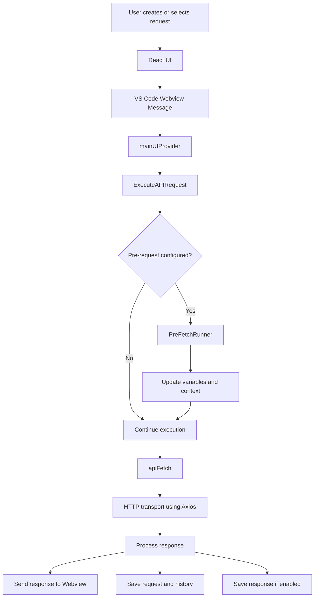
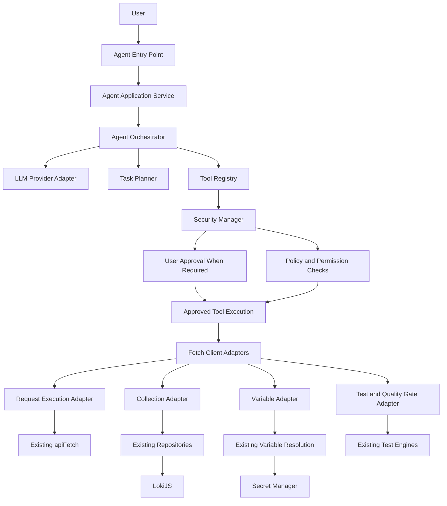
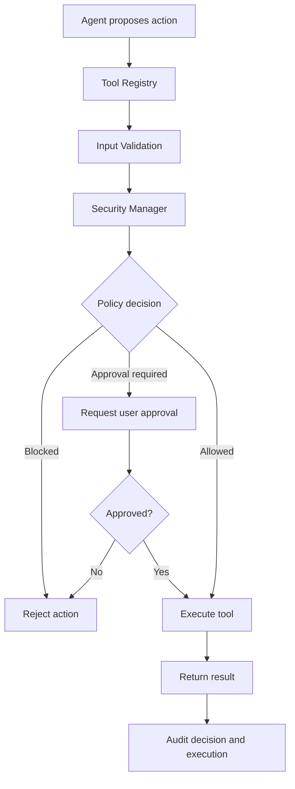

# 03 — Reusable Services and AI Agent Boundaries

**Project:** Fetch Client AI Agent **Phase:** Phase 0 — Product Goal and Preparation **Session:** Day 4 **Document type:** Architecture Analysis and Design Decision **Status:** Initial analysis completed; proposed interfaces and boundaries require
implementation validation **Location:** `docs/ai-agent/02-architecture/03-reusable-services-and-agent-boundaries.md`

---

## 1. Purpose

The purpose of this document is to identify existing Fetch Client services that can be reused by the AI Agent and define clear boundaries between:

- Existing Fetch Client functionality.
- New AI Agent functionality.
- Infrastructure and platform-specific functionality.
- Security and permission enforcement.

The objective is to avoid duplicating functionality that Fetch Client already provides.

For example, the AI Agent should not implement a new HTTP client when Fetch Client already has `apiFetch()`. Instead, it should understand the user's request, prepare an execution plan, and invoke the existing request execution capability through a
controlled interface.

This approach will help us:

- Reuse existing and tested functionality.
- Avoid duplicate business logic.
- Keep the AI Agent independent of the VS Code extension.
- Support future CLI and web UI integration.
- Make the Agent easier to test and maintain.
- Introduce security controls before allowing the Agent to execute operations.

## 2. Architectural principle

### 2.1 The AI Agent is an orchestration layer

The Fetch Client AI Agent will act as an orchestration and reasoning layer.

Its responsibilities will include:

1. Understanding the user's instructions.
2. Identifying the requested task.
3. Breaking complex tasks into smaller steps.
4. Selecting appropriate tools.
5. Gathering the required context.
6. Preparing structured execution plans.
7. Requesting approval when necessary.
8. Calling approved Fetch Client services.
9. Interpreting execution results.
10. Presenting results to the user.

The Agent should not directly own or implement:

- HTTP request execution.
- Database persistence.
- Variable encryption and decryption.
- Authentication implementation.
- TLS and certificate handling.
- Existing pre-request execution logic.
- Collection and request storage.
- Existing performance-testing engines.
- Existing Quality Gate execution.

These capabilities should remain independent of the AI Agent.

### 2.2 Separation of responsibilities

| Component                      | Primary responsibility                                         |
| ------------------------------ | -------------------------------------------------------------- |
| AI Agent                       | Understand, reason, plan and orchestrate                       |
| Security Manager               | Validate permissions, policies and risks                       |
| Tool Registry                  | Define available Agent capabilities                            |
| Existing Fetch Client services | Execute established business functionality                     |
| Database repositories          | Persist and retrieve application data                          |
| Platform adapters              | Connect Agent capabilities to VS Code, CLI and other platforms |
| LLM provider                   | Interpret instructions and generate proposed actions           |

**Important:** The LLM is not the authority for deciding whether an operation is safe. The Security Manager must independently validate every operation before execution.

## 3. Existing Fetch Client architecture reviewed

The following files were inspected to understand the existing implementation.

| File                                                        | Existing responsibility                                |
| ----------------------------------------------------------- | ------------------------------------------------------ |
| `fetch-client-core/utils/fetchUtil.ts`                      | HTTP request execution                                 |
| `fetch-client-core/db/dbManager.ts`                         | LokiJS database caching and persistence infrastructure |
| `fetch-client-vscode/webviews/mainUIProvider.tsx`           | VS Code webview and message handling                   |
| `fetch-client-vscode/helper.ts`                             | VS Code request execution orchestration                |
| `fetch-client-vscode/db/collectionDB.repository.ts`         | Collection operations and some request execution       |
| `fetch-client-vscode/db/variableDB.repository.ts`           | Variable storage and encryption                        |
| `fetch-client-core/helpers/variable.server.helper.ts`       | Variable replacement and AWS secret resolution         |
| `fetch-client-core/utils/preFetchService/preFetchRunner.ts` | Pre-request execution                                  |

The reviewed implementation already contains useful reusable functionality. However, some services have dependencies on VS Code configuration, extension infrastructure or other platform-specific components.

Therefore, reuse does not necessarily mean importing and calling every existing function directly. Some services will need adapters or dependency-injection improvements.

## 4. Existing request execution flow

### 4.1 Current manual request execution

The existing manual request flow can be represented as follows:



This is the current manual execution model based on the inspected implementation.

### 4.2 Important components in the flow

**A. React UI and Webview**

The user interacts with the existing request editor.

The UI communicates with the VS Code extension through webview messages.

`mainUIProvider.tsx` is responsible for handling these interactions and connecting the UI with extension functionality.

**B. ExecuteAPIRequest()**

File: `fetch-client-vscode/helper.ts`

This function coordinates request execution within the VS Code extension.

It handles:

- Reading request information from the message.
- Reading settings and variable data.
- Running parent-level pre-requests.
- Running request-level pre-requests.
- Refreshing variable information.
- Publishing variable updates.
- Calling the main request execution function.
- Sending responses to the webview.
- Updating request and history data.
- Saving response data when enabled.

This function is platform-specific orchestration.

**Architecture decision:** Do not make `ExecuteAPIRequest()` the Agent's primary execution interface.

Instead, expose the underlying capabilities through an independent application service that can be used by different entry points.

**C. apiFetch()**

File: `fetch-client-core/utils/fetchUtil.ts`

This is an important reusable capability.

It handles:

- Request authentication.
- Header processing.
- Variable substitution.
- Request body construction.
- Form-data and URL-encoded bodies.
- Raw and GraphQL bodies.
- AWS request signing.
- TLS/HTTPS agent configuration.
- Axios request execution.
- Timeout and cancellation.
- Response processing.
- Error handling.
- Request logging.

**Architecture decision:** Reuse `apiFetch()` through a controlled request execution adapter.

The Agent must not create its own HTTP execution engine for ordinary Fetch Client requests.

**D. Response processing and persistence**

The existing VS Code flow sends the response to the webview and updates request history and saved response data.

The Agent should receive a normalized execution result through its application interface. It should not depend on webview messages to obtain results.

## 5. Reusable service inventory

This section identifies what can be reused, what needs modification and what should remain outside the Agent.

### 5.1 HTTP request execution — apiFetch()

**Existing file:** `fetch-client-core/utils/fetchUtil.ts`

**Current responsibility:**

Execute an HTTP request using the request model, variables, settings and execution configuration.

**Reusable functionality:**

- HTTP methods.
- Headers.
- Authentication.
- Request body types.
- Variable substitution.
- AWS signing.
- TLS configuration.
- Timeout.
- Cancellation.
- Response information.
- Error information.

**Recommended Agent usage:**

The Agent prepares a request model and passes it to an application-level request execution service.

The service invokes `apiFetch()` internally.

The Agent receives the execution result and uses it to continue the workflow.

**Required improvements:**

1. Separate VS Code configuration access from request execution.
2. Define a platform-independent execution context.
3. Provide a controlled way to pass cancellation information.
4. Define a consistent result type.
5. Ensure secrets are not included in Agent-facing results.
6. Validate the destination and request permissions before execution.
7. Define safe handling for binary files and file uploads.

**Important security consideration:**

The existing implementation supports AWS signing with access keys, secret access keys and session tokens.

These values are needed by the execution engine but must never be exposed to the LLM.

The Agent should receive only safe metadata, such as:

- Authentication type: AWS.
- Authentication configured: Yes.
- Credential source: Configured profile or stored configuration.

It should not receive actual credentials.

**Decision:** Reuse with an execution adapter and security checks.

### 5.2 Database cache — dbManager.ts

**Existing file:** `fetch-client-core/db/dbManager.ts`

**Current responsibility:**

Provide LokiJS database loading, caching and persistence infrastructure.

The implementation provides:

- `createDBCache()`
- `createNoopCache()`
- `createAutoDBCache()`
- `DBCache` interface.

It also manages:

- Database loading.
- Concurrent loading protection.
- In-memory caching.
- External file change detection.
- Save operations.
- Debounced persistence.
- Flush operations.
- Cache invalidation.
- Optional cache expiration.

**Recommended Agent usage:**

The Agent should not directly use the LokiJS database cache.

It should access application data through repository or application-service interfaces.

For example:

```text
AI Agent
    |
    v
Collection Service
    |
    v
Collection Repository
    |
    v
DB Cache
    |
    v
LokiJS
```

**Why?**

Direct database access would couple Agent logic to LokiJS, database collection names and persistence implementation.

It would also make future database changes more difficult.

**Decision:** Reuse indirectly through existing repositories. Keep database infrastructure independent of the Agent.

### 5.3 Collection repository

**Existing file:** `fetch-client-vscode/db/collectionDB.repository.ts`

**Current responsibility:**

Manage collection-related data.

Available operations include:

- Create collection.
- Add request to collection.
- Retrieve all collections.
- Retrieve collection by ID.
- Retrieve collection requests.
- Retrieve folder information.
- Resolve collection and folder settings.
- Update collection settings.
- Delete collections and items.
- Rename collection items.
- Duplicate collection items.
- Attach variables to collections.

The repository also contains:

- `Col_Repository_ExecuteRequest()`
- `Col_Repository_ExecuteMultipleRequests()`

These execution functions call `apiFetch()` directly.

**Recommended Agent usage:**

The Agent needs collection capabilities for tasks such as:

- Find a collection.
- Read requests from a collection.
- Find a folder.
- Retrieve a request.
- Save a generated request.
- Add generated requests to an existing collection.

These should be exposed through a controlled collection service.

**Important architectural observation:**

The current collection repository combines persistence operations with request execution.

It also has dependencies on VS Code extension infrastructure, including `pubSub`.

This is a coupling point that should be considered during refactoring.

**Recommended future separation:**

```text
Collection Application Service
          |
          +---- Collection Repository
          |           |
          |           +---- Collection persistence
          |
          +---- Request Execution Service
                      |
                      +---- apiFetch()
```

The proposed separation does not mean the existing repository must be rewritten immediately.

We can initially expose a safe adapter over the current repository and refactor the internals incrementally.

**Decision:** Reuse through a collection adapter. Consider separating persistence and execution responsibilities.

### 5.4 Variable repository

**Existing file:** `fetch-client-vscode/db/variableDB.repository.ts`

**Current responsibility:**

Manage variable storage and related operations.

Available functionality includes:

- Insert variables.
- Update variables.
- Retrieve all variables.
- Retrieve variables by ID.
- Retrieve global variables.
- Delete variables.
- Rename variables.
- Enable or disable variables.
- Encrypt variable data.
- Decrypt variable data.
- Re-encrypt variables when the encryption key changes.

The repository uses `FCCipher` for encryption and decryption.

**Recommended Agent usage:**

The Agent may need variables to:

- Identify available variable names.
- Understand which variables are configured.
- Resolve a variable for request execution.
- Save or update variables when the user explicitly requests it.

However, variable access must be restricted.

**Security concern:**

The existing `Var_Repository_FindAll()` and `Var_Repository_FindById()` functions can return decrypted variable data when an encryption key is supplied.

This means the repository must not be exposed directly as an unrestricted Agent tool.

**Recommended variable access levels:**

| Access level  | Description                                               |
| ------------- | --------------------------------------------------------- |
| Metadata      | Variable name, ID, active status and scope                |
| Resolve       | Resolve a specific variable for an approved operation     |
| Write         | Create or update a variable after permission checks       |
| Secret access | Restricted resolution through a secure execution boundary |

The LLM should not receive the complete decrypted variable collection.

For example:

The Agent can know that `base_url` exists and is active without needing to receive every variable value.

If a request needs `{{api_token}}`, the variable should be resolved within the execution path.

**Decision:** Reuse through a controlled variable service. Do not expose unrestricted decrypted variable data to the Agent.

### 5.5 Variable replacement service

**Existing file:** `fetch-client-core/helpers/variable.server.helper.ts`

**Current function:**

`replaceValueWithVariable()`

**Current responsibility:**

Replace variable expressions in request data.

It supports variable replacement in:

- URL.
- Query parameters.
- Headers.
- Authentication fields.
- AWS authentication fields.
- OAuth configuration.
- URL-encoded body.
- Form-data body.
- Raw body.
- GraphQL query.
- GraphQL variables.

It also supports:

- Plain variables.
- System variables.
- AWS secret variables.

Existing AWS secret variable syntax:

```text
{{aws:profile:secretName:property}}
```

The implementation uses `getSecretCached()` to retrieve AWS secrets.

**Recommended Agent usage:**

The Agent should reuse the existing variable syntax and resolution behavior.

We should not introduce a second variable syntax specifically for AI-generated requests.

**Important implementation consideration:**

`replaceValueWithVariable()` modifies the request object passed to it.

The current `apiFetch()` path clones request data before performing variable substitution through `updateVariables()`.

Other callers should follow the same principle when they need to preserve the original request.

**Security consideration:**

AWS secret values must remain within the secure variable-resolution and execution path.

They should never be copied into LLM prompts, conversation history or ordinary Agent logs.

**Decision:** Reuse the existing variable resolution functionality, with controlled access and immutable input handling.

### 5.6 Pre-request execution engine

**Existing file:** `fetch-client-core/utils/preFetchService/preFetchRunner.ts`

**Current class:**

`PreFetchRunner`

**Current responsibility:**

Execute configured pre-requests before the main request.

It supports:

- Sequential pre-request execution.
- Context loading.
- Condition evaluation.
- Nested pre-requests.
- Circular dependency detection.
- Failure handling.
- Response processing.
- Variable updates.
- Main request continuation decisions.

The class accepts an `IPreFetchContextProvider`.

This is a useful abstraction because it separates context retrieval from some of the pre-request business logic.

**Recommended Agent usage:**

The Agent should not create a new pre-request engine.

If an AI-generated request uses existing pre-request functionality, the Agent should invoke the existing engine through the request execution workflow.

**Required improvements:**

The current implementation has direct dependencies on:

- `apiFetch()`.
- `getVariableEncryptionConfiguration()`.
- `getVariableEncryptionKey()`.
- Logging infrastructure.

The VS Code-specific configuration dependencies should eventually be moved behind injected interfaces.

For example:

```text
PreFetchRunner
      |
      +---- IPreFetchContextProvider
      |
      +---- IRequestExecutionService
      |
      +---- IVariableSecurityProvider
      |
      +---- ILogger
```

This would make the pre-request engine easier to reuse from the CLI and future Agent entry points.

**Decision:** Reuse the business logic, but introduce dependency injection for platform-specific dependencies.

### 5.7 VS Code Webview and UI provider

**Existing file:** `fetch-client-vscode/webviews/mainUIProvider.tsx`

**Current responsibility:**

Handle communication between the VS Code extension and the webview UI.

It coordinates UI messages and calls extension-side functionality.

**Recommended Agent usage:**

The Agent should not directly depend on `mainUIProvider.tsx`.

The webview can become one of the entry points through which a user interacts with the Agent.

However, the Agent core must not know about:

- VS Code Webview objects.
- `postMessage()`.
- VS Code commands.
- VS Code window APIs.
- VS Code UI state.
- Webview-specific message types.

**Recommended structure:**

```text
VS Code Webview
        |
        v
Agent UI Adapter
        |
        v
AI Agent Application Service
```

This allows the same Agent application service to be used from the CLI or another UI in the future.

**Decision:** Keep UI communication independent of the Agent core.

### 5.8 VS Code execution orchestration

**Existing file:** `fetch-client-vscode/helper.ts`

**Existing function:**

`ExecuteAPIRequest()`

**Current responsibility:**

Coordinate request execution in the VS Code extension.

It combines pre-request handling, variable updates, request execution, webview communication and persistence-related operations.

**Recommended Agent usage:**

Do not call this function directly from the Agent core.

Instead, identify the reusable capabilities it coordinates and expose them through platform-independent interfaces.

**Decision:** Keep `ExecuteAPIRequest()` as a VS Code entry-point orchestration function.

---

## 6. Consolidated reuse decision

| Existing component           | Reuse decision          | Required action                              |
| ---------------------------- | ----------------------- | -------------------------------------------- |
| `apiFetch()`                 | Reuse                   | Add execution adapter and security checks    |
| `dbManager.ts`               | Reuse indirectly        | Access through repositories                  |
| Collection repository        | Reuse selectively       | Add collection service/adapter               |
| Variable repository          | Reuse selectively       | Add controlled variable access               |
| `replaceValueWithVariable()` | Reuse                   | Protect secrets and clone mutable input      |
| `PreFetchRunner`             | Reuse with improvements | Introduce dependency injection               |
| `mainUIProvider.tsx`         | Keep independent        | Add a separate Agent UI adapter              |
| `ExecuteAPIRequest()`        | Do not reuse directly   | Retain as VS Code-specific orchestration     |
| AWS secret service           | Reuse indirectly        | Keep secret values outside the LLM           |
| Existing Quality Gate        | Reuse                   | Invoke through a controlled tool interface   |
| Existing performance engine  | Reuse                   | Invoke through a controlled tool interface   |
| Existing data-driven testing | Reuse                   | Invoke through a controlled tool interface   |
| LokiJS repositories          | Reuse indirectly        | Keep persistence behind application services |

The last three existing capabilities are identified as reuse candidates from the existing Fetch Client feature set. Their detailed internal interfaces have not yet been inspected as part of this Day 4 code review.

## 7. Proposed AI Agent architecture

The following is a proposed target architecture, not a description of code that has already been implemented.



### 7.1 Agent Entry Point

The entry point receives user instructions.

Possible entry points:

- VS Code extension UI.
- CLI.
- Future web UI.

Each entry point should translate its platform-specific input into a common Agent request.

### 7.2 Agent Application Service

This service manages the Agent workflow.

Responsibilities:

- Start a task.
- Maintain task context.
- Invoke the orchestrator.
- Coordinate task execution.
- Return the final result.

It should not depend on VS Code UI components.

### 7.3 Agent Orchestrator

The orchestrator is responsible for coordinating the workflow.

Example:

User instruction:

"Generate positive and negative test cases for the selected API and save them in my collection."

The orchestrator should:

1. Understand the instruction.
2. Identify the selected API.
3. Retrieve the required request information.
4. Ask the LLM to propose test cases.
5. Validate the generated output.
6. Submit proposed actions to the Security Manager.
7. Request approval if required.
8. Save approved test cases through the appropriate Fetch Client service.
9. Return the result.

The orchestrator should not directly write to LokiJS.

### 7.4 LLM Provider Adapter

The LLM provider adapter should isolate the Agent from a particular model provider.

Its responsibilities include:

- Send approved context to the model.
- Receive model responses.
- Normalize provider-specific response formats.
- Handle provider errors.
- Support model configuration.

The Agent should not depend directly on a specific provider SDK.

This allows the project to change or add model providers without redesigning the Agent workflow.

### 7.5 Tool Registry

The Tool Registry describes capabilities available to the Agent.

Examples:

- Get collection.
- Get request.
- Generate request.
- Generate test cases.
- Execute request.
- Save request.
- Run Quality Gate.
- Run data-driven tests.

The registry should define each tool's:

- Name.
- Description.
- Input schema.
- Output schema.
- Required permission.
- Risk classification.
- Approval requirement.
- Execution handler.

A tool being registered does not automatically mean the Agent is allowed to execute it.

The Security Manager must still validate each invocation.

### 7.6 Security Manager

The Security Manager is a mandatory boundary between Agent-generated actions and actual execution.

Its responsibilities should include:

- Validate requested operations.
- Check user permissions.
- Check operation risk.
- Validate target environment.
- Validate request destinations.
- Prevent access to restricted data.
- Detect prohibited operations.
- Require approval for sensitive operations.
- Record security decisions.

The LLM must never be able to bypass this component by generating a tool call directly.

### 7.7 Fetch Client adapters

Adapters expose existing Fetch Client functionality through controlled contracts.

They translate Agent-level requests into existing service calls.

For example:

```text
Agent Tool:
    ExecuteRequest

        |
        v

Request Execution Adapter

        |
        v

Existing Request Execution Service

        |
        v

apiFetch()
```

The adapter should not reimplement HTTP request execution.

---

## 8. Proposed service interfaces

The following interfaces are initial design proposals. They are not existing implementations and should be refined after the Agent responsibilities and tool contracts are defined.

### 8.1 Request execution interface

```ts
interface IRequestExecutionService {
  execute(request: IRequestModel, context: RequestExecutionContext): Promise<RequestExecutionResult>;
}

interface RequestExecutionContext {
  collectionId?: string;
  folderId?: string;
  environmentId?: string;
  cancellationSignal?: AbortSignal;
}

interface RequestExecutionResult {
  status: number;
  statusText: string;
  duration: number;
  responseData?: unknown;
  headers: Record<string, string>;
  isError: boolean;
}
```

The execution result is illustrative. The final contract must preserve Fetch Client's existing response semantics and binary-response behavior.

### 8.2 Collection service interface

```ts
interface ICollectionService {
  getCollection(id: string): Promise<ICollections | null>;

  getRequests(collectionId: string, folderId?: string): Promise<IRequestModel[]>;

  saveRequest(collectionId: string, request: IRequestModel): Promise<void>;
}
```

Responsibilities:

- Retrieve collections.
- Retrieve requests.
- Retrieve folders.
- Save generated requests.
- Update collection contents.

### 8.3 Variable service interface

```ts
interface IVariableService {
  listMetadata(context: VariableContext): Promise<VariableMetadata[]>;

  resolve(expression: string, context: VariableContext): Promise<ResolvedVariable>;

  save(variable: VariableInput): Promise<void>;
}
```

The `ResolvedVariable` contract must not automatically expose sensitive values to the LLM.

Secret resolution should be handled separately through a protected execution context.

### 8.4 Pre-request service interface

```ts
interface IPreRequestService {
  run(request: IRequestModel, context: PreRequestContext): Promise<PreRequestResult>;
}
```

This interface should delegate to the existing pre-request engine.

### 8.5 Security Manager interface

```ts
interface ISecurityManager {
  evaluate(action: AgentAction, context: SecurityContext): Promise<SecurityDecision>;
}

interface SecurityDecision {
  allowed: boolean;
  requiresApproval: boolean;
  reason: string;
  riskLevel: "low" | "medium" | "high" | "critical";
}
```

This is a conceptual starting point. The final policy model must define prohibited actions, permissions and approval behavior separately.

### 8.6 Tool execution interface

```ts
interface IAgentTool {
  name: string;
  description: string;

  validateInput(input: unknown): ValidationResult;

  execute(input: unknown, context: AgentToolContext): Promise<AgentToolResult>;
}
```

Tool implementations should invoke application services rather than directly accessing database infrastructure.

---

## 9. Security and data boundaries

Security is one of the most important architectural requirements for this project.

The Agent may process request information, authentication configuration, variables, API responses and external service information.

Not all of this information should be sent to an LLM.

### 9.1 Data classification

A proposed classification:

| Data category                   | Examples                                      | LLM access                            |
| ------------------------------- | --------------------------------------------- | ------------------------------------- |
| Public metadata                 | HTTP method, request name                     | Allowed when needed                   |
| Non-sensitive request data      | Public API paths, non-secret parameters       | Allowed when needed                   |
| Configuration metadata          | Authentication type, variable name            | Allowed when needed                   |
| Sensitive request data          | Personal data, private API responses          | Restricted; require policy evaluation |
| Credentials                     | Passwords, tokens, API keys                   | Never expose by default               |
| Secret Manager values           | AWS secret values                             | Never expose                          |
| Encryption keys                 | Fetch Client encryption key                   | Never expose                          |
| Internal security configuration | Security policies and protected configuration | Restricted                            |

The classification is a proposed policy and must be implemented with explicit rules.

### 9.2 Secret handling

Consider this request:

```http
GET {{base_url}}/users
Authorization: Bearer {{api_token}}
```

The Agent may need to understand that:

- The request uses a variable for its base URL.
- The request uses bearer authentication.
- A token variable is configured.

However, it does not need to receive the actual bearer token.

The secure execution path should resolve the variable and provide the resulting value only to the component that needs it.

### 9.3 Request mutation

Existing variable substitution modifies request objects.

Therefore:

- Preserve the original saved request.
- Clone request data before variable substitution.
- Do not modify saved request data as a side effect of AI planning.
- Save changes only through an approved operation.

### 9.4 Prompt and response boundaries

The Agent should also protect against untrusted content.

Examples:

- API response content containing instructions.
- OpenAPI descriptions containing malicious prompt text.
- User-provided files.
- External documentation.
- Generated test data.

Such content should be treated as data, not as trusted Agent instructions.

### 9.5 Security Manager execution sequence



**Important design rule:** User approval does not override an action that is prohibited by policy. A prohibited action remains blocked.

---

## 10. What must remain independent of the AI Agent?

The following existing functionality should remain independent.

### 10.1 Request execution engine

The HTTP execution engine must work without an LLM.

It should continue to support manual execution and CLI execution.

### 10.2 Database and persistence

LokiJS and repositories must not depend on the Agent.

The Agent should be another consumer of application services.

### 10.3 Variable resolution

Variable syntax, encryption and decryption must not be implemented inside the Agent.

The Agent should reuse the existing variable functionality.

### 10.4 Authentication and TLS

Authentication and TLS are established Fetch Client capabilities.

The Agent may select an authentication configuration or prepare a request, but actual authentication and TLS processing must remain within existing execution infrastructure.

### 10.5 Pre-request execution

The Agent should use existing pre-request functionality rather than implementing another execution engine.

### 10.6 Existing testing functionality

Quality Gate, data-driven testing and performance testing should remain separate engines.

The Agent may invoke them through approved tools.

### 10.7 Platform-specific functionality

VS Code UI, CLI command handling and future web UI integrations should remain platform-specific.

The Agent core should not import platform-specific modules.

---

## 11. Proposed project structure

The following is a proposed structure, not a recommendation to move all existing files immediately.

```text
src/
│
├── fetch-client-core/
│   ├── db/
│   ├── helpers/
│   ├── types/
│   └── utils/
│
├── fetch-client-agent/
│   │
│   ├── domain/
│   │   ├── models/
│   │   ├── types/
│   │   └── policies/
│   │
│   ├── application/
│   │   ├── orchestrator/
│   │   ├── planner/
│   │   ├── services/
│   │   └── ports/
│   │
│   ├── tools/
│   │   ├── registry/
│   │   ├── request/
│   │   ├── collection/
│   │   ├── variable/
│   │   └── testing/
│   │
│   ├── security/
│   │   ├── securityManager/
│   │   ├── policies/
│   │   ├── validators/
│   │   └── audit/
│   │
│   ├── infrastructure/
│   │   ├── llm/
│   │   ├── adapters/
│   │   └── persistence/
│   │
│   └── types/
│
├── fetch-client-vscode/
│   ├── webviews/
│   └── ...
│
├── fetch-client-cli/
│   └── ...
│
└── fetch-client-ui/
    └── ...
```

### 11.1 Folder responsibilities

| Folder                       | Responsibility                                            |
| ---------------------------- | --------------------------------------------------------- |
| `domain`                     | Agent domain models, action definitions and core policies |
| `application`                | Agent workflows and orchestration                         |
| `application/ports`          | Interfaces for required dependencies                      |
| `tools`                      | Capabilities exposed to the Agent                         |
| `security`                   | Policy validation, permissions and audit                  |
| `infrastructure/llm`         | Model provider implementations                            |
| `infrastructure/adapters`    | Implementations of Fetch Client service interfaces        |
| `infrastructure/persistence` | Agent-specific persistence, if required                   |
| `types`                      | Shared Agent-specific types                               |

Do not create all these folders immediately. Start with the minimum required structure and introduce modules as responsibilities become clear.

---

## 12. Dependency rules

The proposed architecture should follow these dependency rules.

| Module               | Can depend on                                   | Should not depend on                          |
| -------------------- | ----------------------------------------------- | --------------------------------------------- |
| Agent domain         | Agent domain types                              | VS Code, LokiJS, Axios, LLM SDK               |
| Agent application    | Domain and application ports                    | Concrete database or platform implementations |
| Tool implementations | Application ports and contracts                 | Direct UI message handlers                    |
| Security Manager     | Action and security contracts                   | LLM-generated authorization decisions         |
| LLM adapters         | LLM provider SDKs and adapter contracts         | LokiJS repositories                           |
| VS Code adapter      | Agent application interfaces and VS Code APIs   | Agent internals implemented as UI logic       |
| Repository adapters  | Existing repositories and application contracts | Agent reasoning logic                         |

The dependency direction should be inward: the Agent application defines what it needs, and external adapters provide those capabilities.

This is consistent with the Ports and Adapters approach. It also supports independent testing and multiple entry points. See
[AWS Prescriptive Guidance — Hexagonal Architecture](https://docs.aws.amazon.com/pdfs/prescriptive-guidance/latest/cloud-design-patterns/cloud-design-patterns.pdf).

---

## 13. Example: Generate API requests from OpenAPI

This example demonstrates how the proposed boundaries work together.

**User instruction:**

"Import the APIs from this Swagger file, generate requests and save them into my Fetch Client collection."

### Step 1 — Understand the task

The Agent identifies the required operations:

- Read the OpenAPI document.
- Extract API definitions.
- Generate Fetch Client request models.
- Save generated requests.

### Step 2 — Read OpenAPI

The Agent uses the existing OpenAPI import capability where suitable.

It should not create a duplicate OpenAPI parser without a specific reason.

### Step 3 — Prepare requests

The Agent prepares request models based on:

- HTTP method.
- URL.
- Path parameters.
- Query parameters.
- Headers.
- Request body.
- Authentication metadata.

### Step 4 — Validate output

Validate that generated request models conform to Fetch Client's existing request model.

### Step 5 — Security validation

The Security Manager checks:

- Input source.
- Generated destinations.
- Potentially sensitive data.
- Requested save operation.
- Applicable permissions.

### Step 6 — Save requests

The Agent calls the collection service.

The collection service delegates to the existing repository.

### Step 7 — Present results

The Agent reports:

- Number of APIs discovered.
- Number of requests generated.
- Number of requests saved.
- Any skipped or invalid APIs.

**Important:** Generating a request and executing a request are different operations. Importing an OpenAPI document must not automatically trigger API execution.

---

## 14. Testing strategy for service boundaries

The architecture should allow the Agent to be tested without launching the complete VS Code extension.

### 14.1 Unit tests

Test the Agent's:

- Task planning.
- Tool selection.
- Input validation.
- Security decisions.
- Workflow orchestration.
- Result interpretation.

These tests should use mock interfaces.

### 14.2 Adapter tests

Test each adapter independently.

Examples:

- Request adapter invokes the existing execution service.
- Collection adapter retrieves and saves requests.
- Variable adapter does not expose restricted values.
- LLM adapter handles provider failures.
- Security adapter blocks prohibited operations.

### 14.3 Integration tests

Test combinations of real services.

Examples:

- Agent generates a request and saves it.
- Agent retrieves a request and executes it.
- Agent generates test cases and saves them.
- Agent invokes a pre-request-enabled execution flow.

### 14.4 Security tests

Security tests must cover:

- Secret values are not included in prompts.
- Encryption keys are not accessible to tools.
- Unauthorized operations are blocked.
- User approval is required where policy specifies.
- Prompt injection from API responses does not grant new permissions.
- The Agent cannot bypass the Security Manager.
- An execution failure does not result in an unintended database write.

---

## 15. Refactoring and implementation roadmap

Do not attempt to refactor all existing services in one step.

A gradual approach is safer.

| Step | Activity                                   | Expected outcome                      |
| ---- | ------------------------------------------ | ------------------------------------- |
| 1    | Document existing service responsibilities | Reuse inventory                       |
| 2    | Define Agent application contracts         | Stable boundaries                     |
| 3    | Create request execution adapter           | Agent can use existing HTTP execution |
| 4    | Create collection adapter                  | Agent can retrieve and save requests  |
| 5    | Create controlled variable adapter         | Safe variable access                  |
| 6    | Refactor pre-request dependencies          | Platform-independent execution        |
| 7    | Implement Security Manager                 | Controlled tool execution             |
| 8    | Add LLM provider adapter                   | Provider-independent model access     |
| 9    | Integrate VS Code entry point              | Agent accessible from extension       |
| 10   | Add CLI entry point                        | Reuse Agent from CLI                  |

The order may change after the tool contracts and security policies are finalized.

---

## 16. Architectural risks and mitigation

| Risk                                                | Impact                           | Mitigation                                      |
| --------------------------------------------------- | -------------------------------- | ----------------------------------------------- |
| Agent directly calls `apiFetch()` everywhere        | Tight coupling                   | Centralize execution through an adapter         |
| Agent directly accesses LokiJS                      | Database dependency              | Use repository interfaces                       |
| Decrypted variables reach the LLM                   | Credential exposure              | Controlled variable service                     |
| AWS secrets enter prompts                           | Secret leakage                   | Resolve secrets only in secure execution        |
| VS Code APIs enter Agent core                       | Platform lock-in                 | Platform adapters                               |
| Collection repository mixes responsibilities        | Difficult maintenance            | Gradual separation of persistence and execution |
| Pre-request engine depends on VS Code configuration | Reuse limitations                | Dependency injection                            |
| LLM decides whether an action is safe               | Security bypass                  | Independent Security Manager                    |
| AI-generated request executes automatically         | Unexpected external side effects | Separate generation and execution permissions   |
| Agent changes existing requests unexpectedly        | Data corruption                  | Clone inputs and require approved writes        |

---

## 17. Design decisions

The following decisions are proposed for the Fetch Client AI Agent.

| ID    | Decision                                                         | Reason                                        |
| ----- | ---------------------------------------------------------------- | --------------------------------------------- |
| D-001 | Agent will be an orchestration layer                             | Prevent duplication of existing functionality |
| D-002 | Existing HTTP engine will be reused                              | Avoid a second request execution engine       |
| D-003 | Agent core will not directly access LokiJS                       | Preserve database independence                |
| D-004 | Variable resolution will use existing Fetch Client functionality | Preserve current variable syntax and behavior |
| D-005 | Secrets will not be exposed to the LLM by default                | Protect credentials                           |
| D-006 | Pre-request engine will be reused                                | Preserve existing behavior                    |
| D-007 | VS Code UI will remain outside Agent core                        | Support future CLI and web integrations       |
| D-008 | Security Manager will validate every tool action                 | Prevent unsafe operations                     |
| D-009 | Agent-facing services will use interfaces                        | Support testing and future replacement        |
| D-010 | Existing features will be refactored incrementally               | Reduce regression risk                        |

These are architectural proposals for the project. They should be confirmed as implementation decisions when the corresponding designs are approved.

---

## 18. What is completed and what remains?

### Completed during Day 4

- [x] Reviewed the existing request execution flow.
- [x] Identified the role of `apiFetch()`.
- [x] Identified VS Code-specific execution orchestration.
- [x] Reviewed database cache infrastructure.
- [x] Reviewed collection repository capabilities.
- [x] Reviewed variable repository capabilities.
- [x] Reviewed variable substitution.
- [x] Reviewed pre-request execution.
- [x] Identified secret-handling boundaries.
- [x] Identified reusable services.
- [x] Identified platform-specific dependencies.
- [x] Defined initial Agent boundaries.
- [x] Proposed service interfaces.

### Not yet implemented

- [ ] Request execution adapter.
- [ ] Collection adapter.
- [ ] Variable adapter.
- [ ] Dependency injection improvements for pre-request execution.
- [ ] Security Manager.
- [ ] Tool Registry.
- [ ] LLM provider adapter.
- [ ] Agent orchestration service.
- [ ] Automated boundary tests.

---

## 19. Day 4 conclusion

The investigation confirms that Fetch Client already contains several capabilities that can be reused by the AI Agent.

The most important reusable components are:

1. `apiFetch()` — HTTP request execution.
2. Collection repository — collection and request access.
3. Variable repository — variable storage.
4. `replaceValueWithVariable()` — variable substitution.
5. `PreFetchRunner` — pre-request execution.
6. `dbManager.ts` — database infrastructure.

However, some of these components have platform-specific dependencies or responsibilities that should be separated before exposing them to the Agent.

The AI Agent should not become another implementation of Fetch Client functionality.

Instead, it should coordinate existing capabilities through controlled application interfaces.

**Final architectural statement:**

> The Fetch Client AI Agent will act as an orchestration and reasoning layer. It will reuse existing Fetch Client services through controlled adapters and interfaces. Request execution, database persistence, variable resolution, authentication,
> pre-request execution and platform-specific integrations will remain independent of the Agent's core. All Agent-initiated tool operations will pass through the Security Manager before execution.

---

## 20. Follow-up for Day 5

**Recommended next objective: Define AI Agent responsibilities, allowed tools and security boundaries.**

Day 4 established which services can be reused.

Day 5 should establish what the Agent is actually allowed to do.

The next document should define:

- Agent responsibilities.
- Supported user tasks.
- Available tools.
- Read-only operations.
- Write operations.
- Execution operations.
- Operations requiring user approval.
- Operations that must always be blocked.
- Security Manager responsibilities.
- Initial permission and risk classifications.

Suggested next document:

`docs/ai-agent/02-architecture/04-agent-responsibilities-and-tool-boundaries.md`

**Expected Day 5 outcome:** A clear and approved list of Agent capabilities and restrictions before selecting an Agent framework or implementing tools.

---

## Appendix A — Source files inspected

The following files were used for this architecture investigation:

1. `fetch-client-core/utils/fetchUtil.ts`
2. `fetch-client-core/db/dbManager.ts`
3. `fetch-client-vscode/webviews/mainUIProvider.tsx`
4. `fetch-client-vscode/helper.ts`
5. `fetch-client-vscode/db/collectionDB.repository.ts`
6. `fetch-client-vscode/db/variableDB.repository.ts`
7. `fetch-client-core/helpers/variable.server.helper.ts`
8. `fetch-client-core/utils/preFetchService/preFetchRunner.ts`

**Scope limitation:** This document records findings from the inspected files and proposes future architecture. It is not a complete audit of every Fetch Client service, every call site or every platform integration. The Quality Gate, performance
testing, data-driven testing and OpenAPI importer have not been fully inspected in this Day 4 review.
