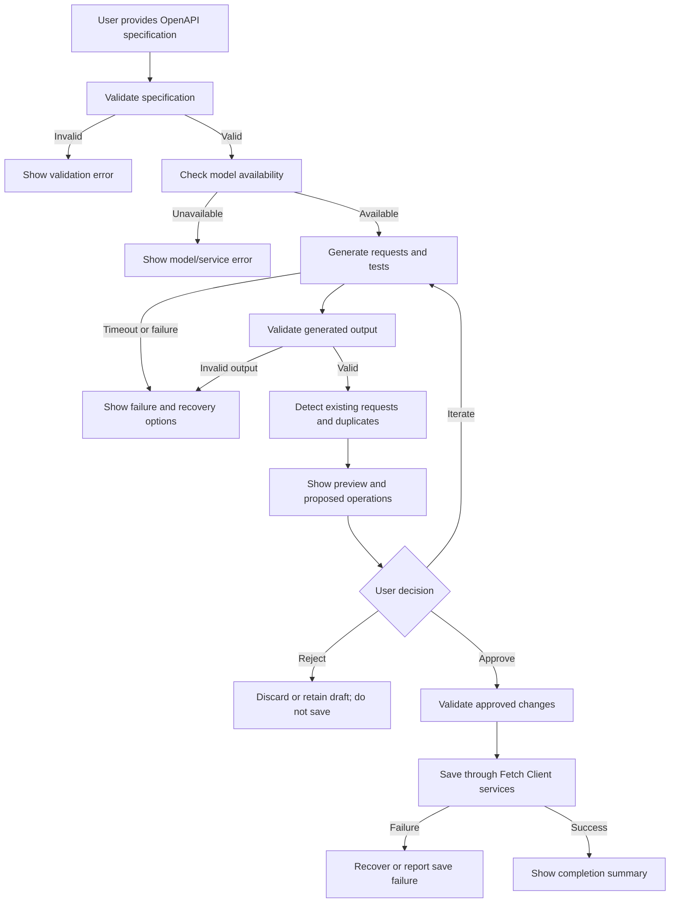
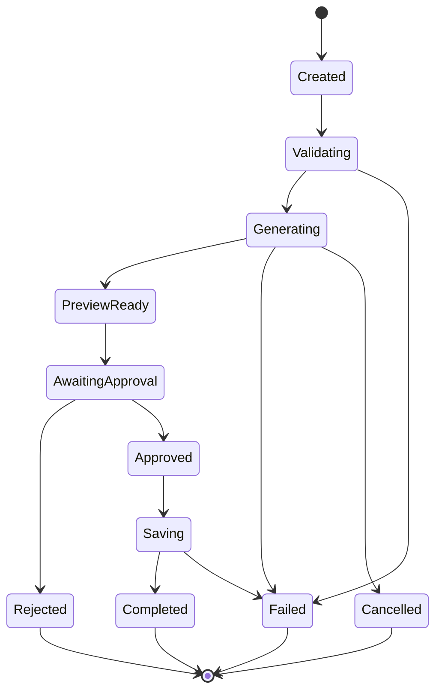

# Day 5 --- First Workflow: Failure Scenarios and Acceptance Criteria

**Phase:** Phase 0 --- Product goal and preparation\
**Session:** Day 5\
**Primary workflow:** OpenAPI import → request/test generation → preview → approval → save\
**Status:** Draft for architecture review\
**Target location in Fetch Client repository:** `docs/ai-agent/02-architecture/first-workflow-spec.md`

---

## 1. Purpose

This document defines how the first Fetch Client AI Agent workflow should behave in both successful and unsuccessful situations.

The goal is not only to describe what the agent generates, but also to define:

- How invalid input and infrastructure failures are handled.
- What the user sees at each stage.
- When an operation can be retried or regenerated.
- How existing collection data is protected.
- How approval controls persistence.
- How success and failure can be verified through measurable acceptance criteria.

The AI Agent proposes changes. Fetch Client remains responsible for application validation, approval enforcement, and persistence.

## 2. First Workflow Overview

The first workflow is:

1. User provides an OpenAPI/Swagger specification.
2. Fetch Client validates and parses the specification.
3. The agent interprets the API definition.
4. The agent generates request definitions and test cases.
5. Fetch Client validates the generated output.
6. User reviews a preview of the proposed changes.
7. User approves, rejects, or iterates on the generated result.
8. Fetch Client saves only the approved changes.

### 2.1 High-level flow



## 3. Failure Scenarios

### 3.1 Invalid Swagger / OpenAPI specification

**Possible causes**

- Invalid JSON or YAML syntax.
- Unsupported OpenAPI version.
- Missing required root properties, such as `openapi` or `paths`.
- Broken or unresolved `$ref` references.
- Invalid parameter, request-body, or response definitions.
- Empty or incomplete specification.

**Expected behaviour**

1. Validate the specification before invoking the AI model.
2. Identify the validation error and, where possible, its file location or JSON/YAML path.
3. Show a useful error message and guidance.
4. Do not generate requests from an invalid specification.
5. Do not modify the existing collection.

**Example user message**

```text
Import failed

File: swagger.json
Location: paths./users.get.responses
Reason: Invalid or missing response definition.

No changes were made to your collection.
```

### 3.2 AI model unavailability

**Possible causes**

- Model provider is unavailable.
- Invalid or expired API credentials.
- Model is not configured.
- Provider rate limit is reached.
- Selected local model is not running.

**Expected behaviour**

- Check model configuration and availability before generation where feasible.
- Show a clear error without exposing secrets or sensitive provider details.
- Offer an appropriate recovery action, such as checking configuration or retrying.
- Do not save any generated or incomplete content.

### 3.3 Invalid or incomplete AI response

**Possible causes**

- Response is not valid JSON.
- Required fields are missing.
- Generated request structure does not match the expected schema.
- Unsupported HTTP method or malformed URL is returned.
- Test cases are incomplete or have invalid assertions.

**Expected behaviour**

1. Validate model output against a defined schema.
2. Reject invalid output before preview or persistence.
3. Where safe, make a bounded repair/regeneration attempt.
4. If the output remains invalid, show a useful error.
5. Never treat unvalidated model output as trusted application data.

### 3.4 Request timeout

**Possible causes**

- Slow model response.
- Large OpenAPI specification.
- Provider overload.
- Network latency.

**Expected behaviour**

- Apply configurable or documented time limits.
- Stop waiting when the timeout policy is reached.
- Cancel the underlying operation when cancellation is supported.
- Inform the user that generation did not complete.
- Allow the user to retry or adjust the input.
- Do not save incomplete output.

A timeout does not always mean the provider stopped processing. The agent should avoid starting duplicate work blindly when the previous operation's outcome is uncertain.

### 3.5 User closes the window or application midway

**Possible situations and expected behaviour**

---

Stage Expected behaviour

---

Swagger validation Stop or abandon the operation safely

AI generation Cancel where supported; do not persist partial output

After generation, before preview Keep generated content separate from the collection

During preview No collection changes

During approval No collection changes until approval is explicitly confirmed

During save Use a recoverable save strategy and determine the final save outcome

---

**Initial recommendation**

- Keep intermediate generation data separate from the main collection.
- Do not save unapproved content.
- Support cancellation where possible.
- Decide separately whether unfinished sessions should be recoverable after application restart.

### 3.6 Network unavailability

**Possible causes**

- Internet connection is lost.
- Model provider cannot be reached.
- Proxy, firewall, or DNS issue.
- Connection is interrupted during generation.

**Expected behaviour**

- Detect and report the network/provider failure.
- Do not save partial model output.
- Offer a user-initiated retry.
- Use bounded automatic retries only for suitable transient failures.
- Avoid retrying indefinitely or duplicating an operation.

### 3.7 User rejects generated content

**Expected behaviour**

- Do not save any proposed changes.
- Keep the existing collection unchanged.
- Allow the user to discard the draft or revise instructions and generate again.
- Make the rejected state clear in the UI.

**Acceptance rule:** Rejection must result in zero collection modifications.

### 3.8 Database save failure / partial save

**Possible causes**

- Database write failure.
- Application closes during persistence.
- Storage is unavailable or full.
- One item in a batch fails validation or persistence.
- An unexpected error occurs while saving requests or test cases.

**Expected behaviour**

1. Validate all approved changes before persistence.
2. Use an all-or-nothing batch operation where feasible.
3. If the storage layer does not support the required transaction, implement staged persistence and explicit rollback or recovery.
4. Report the save outcome accurately.
5. Do not report success until persistence is confirmed.

**Desired initial behaviour:** A failed batch should leave the collection unchanged.

If this cannot be guaranteed by the existing LokiJS persistence design, document the limitation and implement a recovery strategy before claiming atomic behaviour.

### 3.9 Duplicate request detection

A request may already exist in the selected collection.

A useful initial duplicate candidate key is:

- HTTP method.
- Normalized URL/path.

This is only a candidate match. Query parameters, request body, authentication, headers, and other configuration may differ.

**Expected behaviour**

- Identify potential duplicates before approval.
- Show existing and generated request details.
- Never silently overwrite an existing request.
- Let the user choose the intended operation.

### 3.10 Context loss and session recovery

The user may close and reopen Fetch Client after generation but before approval.

**Expected behaviour for the first version**

- Unapproved content must not appear as saved collection data.
- If draft recovery is not supported, explain that the unfinished session was not retained.
- If draft recovery is implemented, clearly distinguish a recovered draft from saved collection data.

Session recovery is an open design decision and is not required for the first implementation unless explicitly added to scope.

## 4. Retry and Recovery Strategy

There are two distinct behaviours.

### 4.1 Automatic retry

Use only for suitable transient infrastructure failures, such as:

- Temporary network interruption.
- HTTP 429 rate limiting, respecting provider retry guidance.
- Temporary model service unavailability.

Automatic retries should be bounded, use an appropriate delay/backoff strategy, and stop when the error is not retryable.

### 4.2 User-initiated retry or iteration

Use when:

- The user wants different requests or test cases.
- The generated result is incomplete or incorrect.
- The user changes instructions.
- The user changes the selected model or generation settings.

A new generation based on changed instructions is an **iteration**, not simply a retry.

The system should not overwrite an earlier draft silently when generating a new iteration.

## 5. Existing Data Protection

The agent must understand the user's intended operation before proposing changes to existing collection data.

### 5.1 Supported operation intents

---

User intent Expected behaviour

---

Create new requests Create new request entries

Append test cases Preserve existing request configuration and append selected new test cases

Replace test cases Show the replacement proposal and require approval

Update an existing request Show field-level differences and require approval

Create a duplicate intentionally Create a separate request only when explicitly requested

---

### 5.2 Append test cases example

Existing request:

```text
GET /users
  Headers
  Query Parameters
  Authorization
  Pre-request
  Test Cases
    - Status code is 200
```

Proposed generated changes:

```text
GET /users
  Test Cases to append
    - Response contains users
    - Response time is below 500ms
```

Expected result after approval:

- Existing URL and HTTP method remain unchanged.
- Existing headers, query parameters, authentication, and pre-request configuration remain unchanged.
- Existing test cases remain unchanged.
- Only the approved new test cases are appended.

### 5.3 Approval preview and selection

**Agreed product requirement:** Users must be able to review and select individual generated requests and test cases before approving changes. The final UI implementation remains a proposal and will be evaluated during the UI architecture/design
session.

The preferred direction is a hybrid approach:

1. Reuse existing Fetch Client request and test-case presentation components wherever practical.
2. Display generated content in a dedicated preview/read-only mode, using temporary proposal data rather than records loaded for editing from LokiJS.
3. Allow users to select or deselect individual requests and individual test cases. A request may be selected with its generated tests, while still allowing individual tests to be deselected.
4. Show a change summary/diff for operations affecting existing requests, especially append, replace, and update.
5. If existing components cannot support a safe and clear preview without coupling to persistence behaviour, use a dedicated AI preview workspace that reuses the existing presentation components.

The preview should show:

- Existing request and its relevant configuration when an existing request is affected.
- Proposed operation: create, append, replace, or update.
- New fields or test cases.
- Fields or test cases that would be changed or removed.
- Potential duplicates and conflicts.
- Which individual requests and test cases are selected for approval.
- The final effect of approving the selected changes.

**Preview safety requirements**

- Preview data must remain separate from the main collection until approval.
- Preview mode must be read-only: editing, deleting, sending requests, and other side-effecting actions must be disabled.
- Reuse presentation components, not database-writing behaviour. Components should receive proposal data through a clear read-only/view-model contract.
- Opening, closing, rejecting, or navigating away from the preview must not modify the collection.
- Approval must apply only to the selected items and the exact proposal version shown to the user.
- If the proposal changes after review, require a new preview and approval.

The user must be able to understand and select exactly what will change before approving it. The hybrid UI direction is preferred, not a final implementation decision.

## 6. Approval and Persistence Rules

1. AI generation must not write directly to the main Fetch Client collection.
2. Generated content must be validated before it is shown as ready for approval.
3. Users must be able to select individual requests and test cases for approval.
4. The preview should preferably reuse existing Fetch Client presentation components in a dedicated read-only mode, backed by temporary proposal data rather than database records. The final UI implementation is subject to a later architecture/design
    review.
5. For changes to existing data, show the proposed operation and its impact, including additions, modifications, and removals.
6. The user must explicitly approve the exact selected proposal/version.
7. Rejected, cancelled, closed, or abandoned proposals must not modify the collection.
8. Persistence must use existing Fetch Client application services/repositories rather than bypassing application boundaries.
9. Existing data must not be overwritten silently.
10. The application must report whether saving succeeded, failed, or has an uncertain outcome.
11. The UI must not show a successful save before persistence is confirmed.
12. If the proposal changes after approval, the previous approval is invalid and a new approval is required.

**Architectural principle:** The AI Agent proposes changes; Fetch Client controls validation, approval enforcement, and persistence.

## 7. Agent Session Lifecycle

Each generation should be treated as a session with a unique session identifier.



Suggested states:

- `Created`
- `Validating`
- `Generating`
- `PreviewReady`
- `AwaitingApproval`
- `Approved`
- `Saving`
- `Completed`
- `Rejected`
- `Cancelled`
- `Failed`

The session lifecycle is a logical model. It does not require every state to be persisted in the first implementation.

## 8. Idempotency and Save Recovery

A save may succeed even if the UI does not receive confirmation---for example, if the application closes immediately after persistence.

If the user retries the same approval, the application must avoid applying the same changes twice.

**Recommendation**

- Assign a unique operation ID to each approved save operation.
- Record or otherwise determine the operation's final outcome.
- Detect repeated submission of the same operation.
- Make repeated execution safe where possible.
- Distinguish a confirmed failure from an uncertain save outcome.

For appending test cases, also consider how duplicate test cases within the same request are identified.

## 9. Measurable Acceptance Criteria

| ID    | Acceptance criterion               | Expected result                                                                                 |
| ----- | ---------------------------------- | ----------------------------------------------------------------------------------------------- |
| AC-01 | Invalid JSON/YAML input            | Rejected before AI invocation                                                                   |
| AC-02 | Unsupported OpenAPI version        | Import rejected with a clear error                                                              |
| AC-03 | Broken `$ref`                      | Error identifies the unresolved reference                                                       |
| AC-04 | Model unavailable                  | User receives an actionable error; no data is saved                                             |
| AC-05 | Invalid AI response                | Output is rejected before preview/save                                                          |
| AC-06 | Request timeout                    | Operation terminates according to timeout policy; no partial output is saved                    |
| AC-07 | Application closes before approval | No unapproved changes are persisted                                                             |
| AC-08 | Network failure                    | No partial model output is persisted                                                            |
| AC-09 | User rejects approval              | Zero collection modifications                                                                   |
| AC-10 | Database save fails                | No partial batch remains, or the documented recovery mechanism restores consistency             |
| AC-11 | Duplicate detection                | Potential matching method/URL candidates are shown before approval                              |
| AC-12 | Append test cases                  | Existing request configuration and existing tests are preserved                                 |
| AC-13 | Replace test cases                 | Proposed removals and additions are visible before approval                                     |
| AC-14 | Explicit approval                  | Only approved changes are persisted                                                             |
| AC-15 | Repeated save submission           | The same approved operation is not applied twice                                                |
| AC-16 | Successful save                    | All approved items are confirmed as persisted before success is displayed                       |
| AC-17 | Preview generated content          | Requests and tests are displayed without writing to the main collection                         |
| AC-18 | Item-level selection               | User can select/deselect individual requests and test cases before approval                     |
| AC-19 | Read-only preview                  | Preview does not allow request execution or collection-changing actions                         |
| AC-20 | Existing UI reuse                  | Preview can reuse existing presentation components without invoking their persistence behaviour |
| AC-21 | Existing-data change review        | Append/replace/update previews show the impact before approval                                  |
| AC-22 | Proposal changes after approval    | Previous approval cannot authorize a changed proposal/version                                   |
| AC-23 | Preview abandoned or rejected      | Closing or rejecting preview leaves collection data unchanged                                   |

These criteria should become automated tests as the workflow is implemented. Where a criterion says "all" or "zero", tests should verify the complete batch and collection state, not only a sample item.

## 10. Open Architectural Decisions

The following decisions need further investigation before implementation:

| ID    | Decision                                                               | Agreed direction / initial recommendation                                                                                                                                                                                                                                                                                                                                            | Status                                | Owner / target session         |
| ----- | ---------------------------------------------------------------------- | ------------------------------------------------------------------------------------------------------------------------------------------------------------------------------------------------------------------------------------------------------------------------------------------------------------------------------------------------------------------------------------ | ------------------------------------- | ------------------------------ |
| OD-01 | Should unfinished sessions survive application restarts?               | Defer recovery implementation; keep drafts separate from collection data                                                                                                                                                                                                                                                                                                             | Deferred                              | Session architecture           |
| OD-02 | Should users approve selected requests/test cases or the entire batch? | Users can select individual requests and test cases. Preferred UI direction: reuse existing Fetch Client presentation components in a read-only preview backed by temporary proposal data, combined with a change summary/diff for existing-data operations. A dedicated preview workspace that reuses those components is the fallback. Final UI implementation is not decided yet. | Requirement decided; UI design open   | UI architecture/design         |
| OD-03 | How should failed saves recover?                                       | Investigate LokiJS capabilities; prefer all-or-nothing persistence. Do not claim atomic behaviour until verified.                                                                                                                                                                                                                                                                    | Open — technical investigation        | Persistence design             |
| OD-04 | Should transient provider failures retry automatically?                | Yes, but only for suitable transient infrastructure failures, with a bounded retry limit and backoff. Content changes/regeneration require user action.                                                                                                                                                                                                                              | Decided                               | Retry/error-handling design    |
| OD-05 | How should duplicate test cases be identified?                         | Define a stable comparison strategy without assuming text equality is sufficient                                                                                                                                                                                                                                                                                                     | Deferred                              | Request/test generation design |
| OD-06 | How should uncertain save outcomes be reconciled?                      | Assign a unique operation ID to each approval/save operation; repeated submission of the same operation must not apply changes twice. Verify final outcome where possible.                                                                                                                                                                                                           | Decided — implementation details open | Persistence/idempotency design |

## 11. Tool Boundaries and Contracts

This section carries forward the Day 4 work on reusable Fetch Client services and the separation between the existing application and the AI Agent.

### 11.1 Boundary principle

The AI Agent must not directly access internal application state, LokiJS collections, repositories, filesystem paths, or arbitrary network capabilities.

Instead, it should request narrowly defined operations through an allowlisted tool/service interface. Fetch Client remains the authority that validates inputs, enforces permissions, applies business rules, and performs side effects.

### 11.2 Proposed responsibility split

| Component                         | Responsibility                                                    | Must not do                                         |
| --------------------------------- | ----------------------------------------------------------------- | --------------------------------------------------- |
| Agent orchestration               | Manage workflow state, model calls, iteration, and tool selection | Directly read/write LokiJS                          |
| OpenAPI validation service        | Parse and validate the supplied specification                     | Execute API requests described by the specification |
| OpenAPI interpretation/generation | Convert validated API definitions into proposed request/test data | Persist generated content                           |
| Existing Fetch Client services    | Apply established collection/request/variable business rules      | Depend on a particular AI model or prompt           |
| Preview/diff service              | Compare proposed changes with existing data and prepare a review  | Save changes                                        |
| Approval controller               | Record the user's explicit decision for a specific proposal       | Treat model output as user approval                 |
| Persistence service/repositories  | Save approved changes using existing application patterns         | Accept unvalidated or unapproved model output       |

This is a logical responsibility split. Reuse existing services where their contracts fit; introduce adapters only where a clear boundary is missing. Do not duplicate existing Fetch Client business logic inside the agent.

### 11.3 Initial allowlisted tool surface

The first workflow should expose only the minimum operations it needs. Candidate tools include:

| Tool operation              | Purpose                                                                | Side effect                     | Approval required                     |
| --------------------------- | ---------------------------------------------------------------------- | ------------------------------- | ------------------------------------- |
| `validateOpenApi`           | Validate and parse user-provided OpenAPI input                         | None                            | No                                    |
| `getCollectionContext`      | Read the minimum collection information needed for duplicate detection | Read-only                       | No; subject to normal access controls |
| `generateRequestProposal`   | Generate request/test proposals from validated input                   | Model call; no collection write | No                                    |
| `validateGeneratedProposal` | Validate generated data against application schemas and rules          | None                            | No                                    |
| `previewProposedChanges`    | Produce a diff and proposed create/append/replace/update operations    | None                            | No                                    |
| `applyApprovedChanges`      | Persist the exact approved proposal                                    | Database write                  | Yes, for the exact proposal/version   |
| `getOperationStatus`        | Check whether a save operation completed                               | Read-only                       | No                                    |

Names are illustrative. They should be aligned with the actual Fetch Client service/API naming during implementation.

Do not expose a generic tool such as `executeCode`, unrestricted database query, arbitrary filesystem access, or unrestricted HTTP request execution to the model.

### 11.4 Tool contract requirements

Every tool should have:

- A clear, narrow purpose.
- A typed input schema and typed output schema.
- Input validation independent of the model.
- A documented permission requirement.
- An explicit side-effect classification: read-only, external call, or write.
- Defined timeout and cancellation behaviour where applicable.
- Structured error codes and safe user-facing messages.
- A trace/session/operation identifier for diagnostics.
- Tests for invalid inputs, unauthorized calls, and failure behaviour.

Tool outputs should return only the data needed for the next workflow step. Avoid returning secrets, unrelated collection data, or unnecessary personal/project data.

### 11.5 Approval binding

Approval must be bound to the exact proposal being saved, not merely to a general statement that the user approved the workflow.

The approval record should identify, as appropriate:

- Agent session ID.
- Proposal/version ID or content hash.
- Selected operations and selected request/test items.
- User decision and timestamp.
- Target collection.
- Save operation ID.

If the proposal changes after preview—for example, because the user regenerates content—the previous approval must no longer authorize the changed proposal. A new preview and approval are required.

## 12. Security and Safety Policy

This section carries forward the Day 4 security-boundary work and defines the minimum policy for the first workflow.

### 12.1 Treat all external and model-produced content as untrusted

The following are untrusted inputs:

- User-provided OpenAPI files.
- OpenAPI descriptions, summaries, examples, and external documentation.
- `$ref` targets and imported content.
- User prompts and additional instructions.
- AI model responses.

OpenAPI descriptions and examples may contain prompt-injection text. Such text must be treated as API documentation data, not as instructions that can change agent policy or authorize tool use.

### 12.2 Least privilege and tool allowlisting

- The model may request only registered, allowlisted tools.
- The application validates every tool call and its arguments.
- Tools receive only the minimum data and permissions required.
- The model must not be given direct database credentials or unrestricted application services.
- Read-only operations and write operations must be distinguishable.
- A model-generated tool call is a proposal, not authorization.

### 12.3 Approval and destructive-operation safeguards

- No collection write before explicit user approval.
- No silent overwrite, deletion, or replacement.
- Preview must identify additions, modifications, and removals.
- Approval applies only to the displayed proposal/version and selected operations.
- A changed proposal requires renewed approval.
- Reject, cancel, timeout, and failed generation paths must not persist unapproved data.

### 12.4 Secrets and sensitive data

- Do not include API keys, passwords, access tokens, private certificates, or secret-manager values in prompts unless a specific, justified workflow requires them and the user has authorized it.
- Redact sensitive values from logs, diagnostics, previews, and model context where possible.
- Do not ask the model to retrieve or reveal secrets.
- Reuse Fetch Client's existing variable and secret-handling mechanisms rather than creating a parallel secret store.
- Do not persist model prompts or responses containing secrets without an explicit data-handling decision.

### 12.5 Network and URL safety

For this first workflow, importing an OpenAPI specification must not automatically execute the API endpoints it describes.

If remote references or external URLs are supported:

- Apply an explicit policy for whether remote `$ref` resolution is allowed.
- Validate URL schemes and destinations.
- Protect against access to localhost, private networks, link-local addresses, and cloud metadata endpoints where remote fetching is enabled.
- Apply size, depth, redirect, and timeout limits.
- Do not let model output bypass these checks.

Actual API execution should be a separate, explicitly authorized workflow with its own security controls.

### 12.6 Output validation and safe rendering

- Validate model output against schemas and Fetch Client business rules.
- Treat generated strings as untrusted when rendering in the UI.
- Do not execute generated scripts, shell commands, or code as part of this workflow.
- Enforce limits on response size, number of generated requests, nesting depth, and test-case count.
- Fail safely when validation cannot establish that output is acceptable.

### 12.7 Auditability and diagnostics

Record enough metadata to investigate an operation without unnecessarily recording sensitive content:

- Session and operation IDs.
- Selected model/provider identifier where appropriate.
- Workflow stage and outcome.
- Tool names invoked.
- Approval decision and proposal version.
- Save result and structured error code.

Do not log credentials, secret values, or unrestricted raw prompts/responses by default. Define retention and user-visible diagnostic behaviour before production use.

### 12.8 Security acceptance criteria

| ID     | Security acceptance criterion                              | Expected result                                                          |
| ------ | ---------------------------------------------------------- | ------------------------------------------------------------------------ |
| SEC-01 | Model requests an unregistered tool                        | Call is rejected                                                         |
| SEC-02 | Tool receives invalid or out-of-scope arguments            | Application validation rejects the call                                  |
| SEC-03 | Model attempts direct persistence without approval         | No database write occurs                                                 |
| SEC-04 | Proposal changes after approval                            | Previous approval is invalidated                                         |
| SEC-05 | OpenAPI description contains prompt-injection instructions | Content is treated as untrusted data; tool policy is unchanged           |
| SEC-06 | Imported specification contains API server URLs            | No endpoint is executed merely because it was imported                   |
| SEC-07 | Model output contains executable code or commands          | It is treated as data and is not executed                                |
| SEC-08 | Sensitive values enter diagnostics                         | Secrets are redacted or excluded                                         |
| SEC-09 | A write operation is invoked                               | It is restricted to the approved proposal and target                     |
| SEC-10 | Remote reference resolution is enabled                     | URL, network destination, size, depth, and timeout policies are enforced |

These criteria define intended safeguards. Their implementation and verification must be completed before the corresponding capability is considered production-ready.

## 13. Architectural Boundaries

### AI Agent responsibilities

- Interpret user instructions.
- Understand the OpenAPI specification.
- Generate request and test proposals.
- Explain generated content and generation errors.
- Suggest changes to existing requests.

### Fetch Client responsibilities

- Validate OpenAPI input and generated application data.
- Detect existing requests and potential duplicates.
- Present proposed changes for user review.
- Enforce explicit approval.
- Save through existing application services and repositories.
- Protect collection integrity.
- Report persistence outcomes.

The AI Agent should not receive unrestricted access to the LokiJS database.

## 14. Day 5 Completion Checklist

- [ ] Document invalid OpenAPI scenarios.
- [ ] Document model availability and generation failures.
- [ ] Document timeout and network failure behaviour.
- [ ] Document application-close and context-loss behaviour.
- [ ] Document rejected approval behaviour.
- [ ] Define partial-save and recovery behaviour.
- [ ] Define duplicate request handling.
- [ ] Define create, append, replace, and update intents.
- [ ] Define the item-level selection and approval requirement.
- [ ] Record the preferred read-only preview direction and keep final UI implementation open for later review.
- [ ] Decide bounded automatic retry policy for transient infrastructure failures.
- [ ] Decide unique operation ID requirement for approval/save operations.
- [ ] Add measurable acceptance criteria.
- [ ] Assign deferred/open decisions to future sessions.
- [ ] Review this document before closing Day 5.

## 15. Key Learning

The AI Agent should generate proposed changes, but Fetch Client must own validation, approval enforcement, and persistence.

Existing user data must never be modified silently.

A successful workflow is not merely one that generates correct requests and tests. It must also protect existing data, explain failures, support safe recovery, and make every persisted change traceable to explicit user approval.
