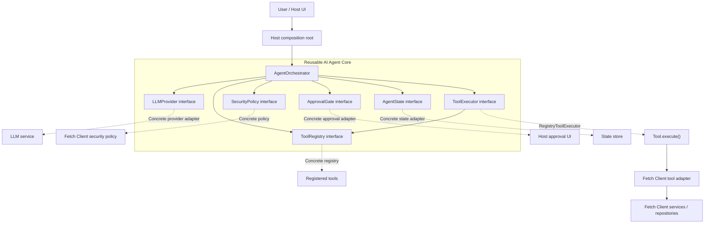
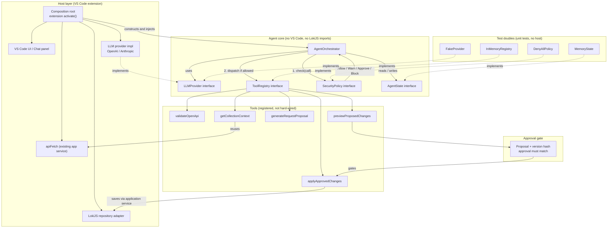
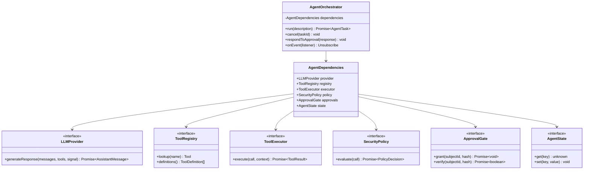
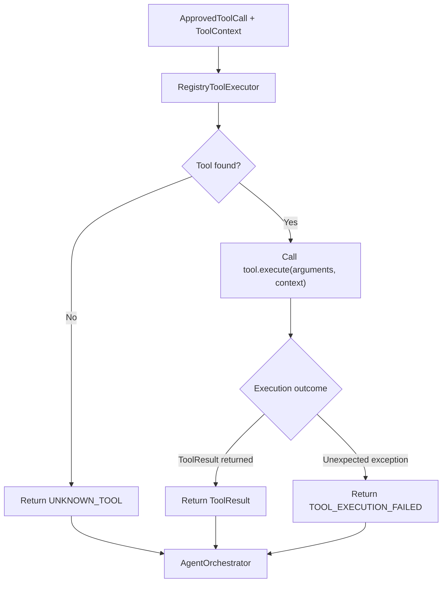
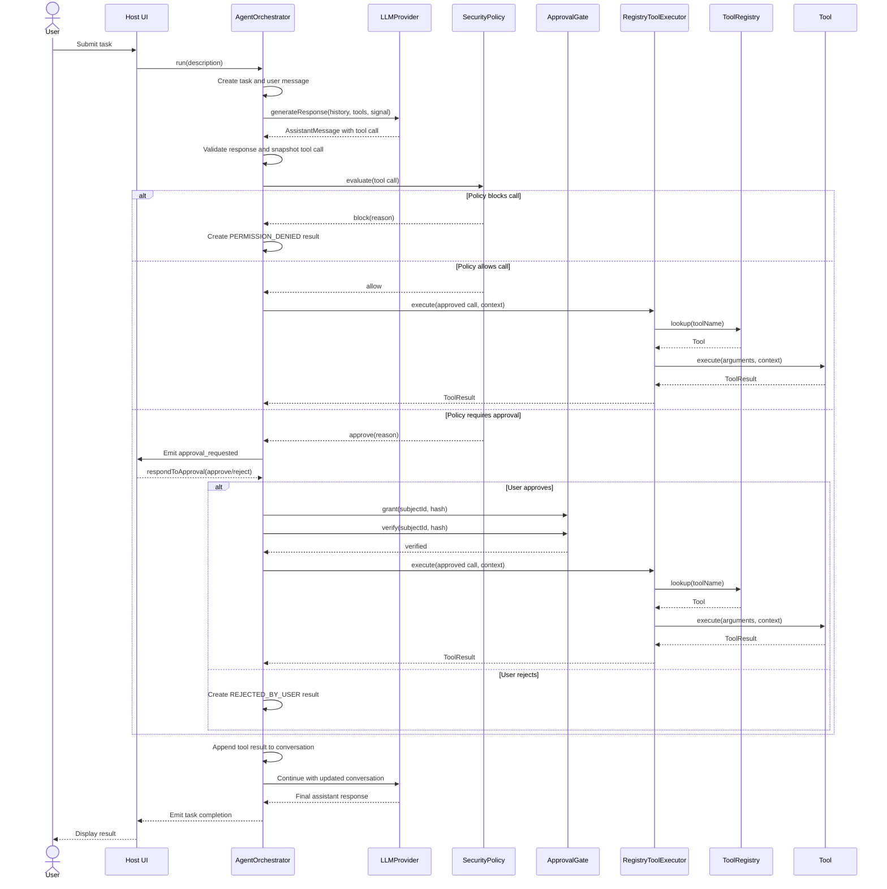
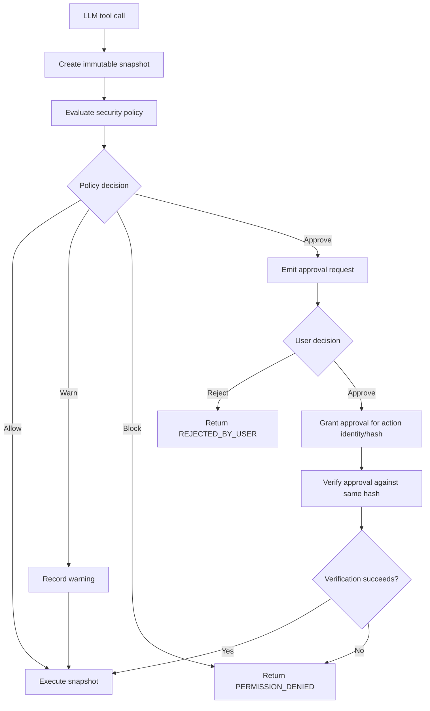
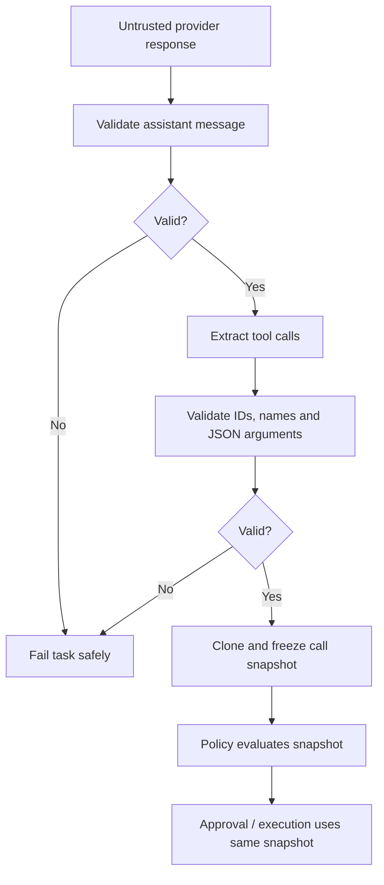
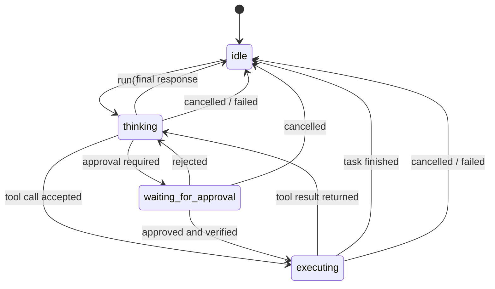

# Session 09: Dependency Injection and Agent Orchestration

**Date:** 20 November 2026\
**Phase:** Phase 1 --- TypeScript Foundations\
**Status:** Completed

## 1. Objective

Build the first working orchestration layer for the Fetch Client AI Agent.

The objective was to move from individual TypeScript contracts and services to a composition of collaborating components. The orchestrator should coordinate LLM responses, tool selection, security decisions, approvals, tool execution, task state,
events, and cancellation without depending directly on Fetch Client's VS Code or database implementation.

The key architectural principle is:

> The AI Agent Core owns orchestration. Host-specific integrations are supplied through interfaces and constructor injection.

## 2. Architecture principles

### 2.1 Separate core logic from host-specific code

The agent engine should be reusable independently of the Fetch Client VS Code extension.

- **Agent Core:** orchestration, contracts, tool execution coordination, policy decisions and approval flow.
- **Fetch Client adapters:** actual Fetch Client tools, repositories, validators and application-specific security rules.
- **Host/composition root:** creates concrete implementations and injects them into the orchestrator.

The core should depend on abstractions rather than importing VS Code APIs, LokiJS, or Fetch Client UI modules.

### 2.2 Constructor-based dependency injection

The orchestrator receives its dependencies once through its constructor.

```ts
const orchestrator = new AgentOrchestrator({
  provider,
  registry,
  executor,
  policy,
  approvals,
  state,
});
```

This keeps the orchestrator independent of concrete implementations and makes it straightforward to substitute fakes in tests.

No DI framework is required for this stage. TypeScript interfaces and constructor injection are sufficient.

## 3. High-level architecture





The dashed relationships represent host-supplied implementations of core interfaces. The core defines what it needs; the composition root decides which implementation to provide.

## 4. Dependency contracts

The orchestrator is constructed with the following dependencies:

---

Contract Responsibility

---

`LLMProvider` Sends conversation history and available tool definitions to the model and returns an assistant response.

`ToolRegistry` Looks up tools by name and exposes tool definitions to the model.

`ToolExecutor` Executes an approved tool call using the registered tool.

`SecurityPolicy` Decides whether a tool call is allowed, warned, requires approval, or blocked.

`ApprovalGate` Grants and verifies approval against the approved action's identity/hash.

`AgentState` Stores agent state values, such as policy warnings.

---

### 4.1 Dependency relationship



_Note: The diagram describes the dependency roles. Keep the actual method and parameter names aligned with the interfaces in the repository._

## 5. Tool execution architecture

`RegistryToolExecutor` is a small adapter between the orchestrator and the registry. It does not decide whether a call is safe or approved. Those decisions belong to the orchestrator's policy and approval flow.

Its responsibilities are deliberately narrow:

1. Look up the requested tool by name.
2. Return an `UNKNOWN_TOOL` failure if no tool is registered.
3. Invoke the tool with its arguments and `ToolContext`.
4. Convert an unexpected thrown exception into a `TOOL_EXECUTION_FAILED` result.



The executor is not a replacement for security policy. It should only receive a call after the orchestrator has completed the required checks.

## 6. End-to-end orchestration flow

The following diagram shows the normal tool-call path, including the policy decision and optional approval.



The model may need another turn after receiving a tool result. The orchestrator therefore appends the tool result to the conversation and asks the provider for the next response. The loop is bounded by a maximum step count to prevent an unbounded
tool-call cycle.

## 7. Security and approval flow

The security policy returns one of four decisions:

---

Decision Orchestrator behavior

---

`allow` Dispatch the tool call.

`warn` Record a warning and dispatch the tool call.

`approve` Pause and request explicit user approval before dispatch.

`block` Do not execute; return a permission-denied tool result.

---

### 7.1 Approval integrity

Before waiting for approval, the orchestrator snapshots the tool call and calculates a stable representation/hash for the action. After approval, it verifies that the approval still corresponds to that action before execution.

This protects the approval decision from being reused for a changed tool call.



**Important implementation note:** A canonical JSON representation is useful for stable comparison, but it is not itself a cryptographic hash. If the implementation currently uses canonical serialization, describe it as a canonical representation
until a cryptographic digest such as SHA-256 is actually implemented.

## 8. Runtime validation and immutable tool-call snapshots

LLM responses are untrusted runtime data. TypeScript types alone do not validate data returned by an external provider.

The orchestrator validates the assistant response and tool calls before using them. Validation should reject malformed values such as:

- A response that is not an object.
- An invalid assistant role or missing required fields.
- `toolCalls` that is not an array.
- Empty tool-call IDs or tool names.
- Duplicate tool-call IDs in one response.
- Arguments containing values that are not valid JSON data, such as `NaN`, infinity, circular structures, or unsupported object types.

The orchestrator also takes a snapshot of the call before policy evaluation and execution. The same snapshot is used throughout the decision path so that the policy and executor operate on the same arguments.



## 9. Cancellation and lifecycle events

The orchestrator supports cancellation through `AbortController` and `AbortSignal`.

The signal is passed to the LLM provider and tool execution context. A provider or tool can observe cancellation and stop work where supported.

The orchestrator also emits events so that the host UI can reflect task progress without directly controlling the internal orchestration loop.

Examples of event categories include:

- `status_changed`
- `task_updated`
- `message_added`
- `message_delta`
- `tool_call_started`
- `tool_call_finished`
- `approval_requested`
- `error`



Cancellation is cooperative: passing a signal does not forcibly terminate arbitrary code. Each provider/tool implementation must respond to the signal appropriately.

## 10. Testing completed

Tests were added for both isolated component behavior and interactions between real core components.

### 10.1 Unit tests

The unit tests exercise `AgentOrchestrator` using test doubles such as:

- `FakeProvider`
- `InMemoryToolRegistry`
- `MockToolExecutor`
- `ConfigurablePolicy`
- `InMemoryApprovalGate`
- `MemoryAgentState`

Covered areas include:

- Initial status and event subscription/unsubscription.
- Listener exception resilience.
- Concurrent task/reentrancy guard.
- Simple text-only task execution and event order.
- Protection against provider mutation of supplied messages/tool definitions.
- Invalid LLM response and invalid tool-call payload handling.
- Maximum step limit.
- Allow, warn, block and approve policy decisions.
- Approval rejection and approval verification failure.
- Unknown approval request handling.
- Cancellation during provider generation and approval waiting.

### 10.2 Integration tests

The integration tests use the actual `AgentOrchestrator` and `RegistryToolExecutor`, with an in-memory registry and realistic tool implementations. The LLM provider remains fake/deterministic so the tests do not require an external model service.

Covered workflows include:

- Multi-turn conversation with real calculator tool execution.
- Approval flow with a tool that mutates in-memory data.
- Blocked destructive operation that leaves data unchanged.
- Tool exception conversion to `TOOL_EXECUTION_FAILED`.
- Unknown tool conversion to `UNKNOWN_TOOL`.
- Cancellation of a long-running tool through `AbortSignal`.

### 10.3 Verification results

Check Result

---

Unit tests Passed Integration tests Passed TypeScript type checking Passed Linting Passed

These results were confirmed during the session.

## 11. Key learning outcomes

By completing this session, the following concepts were applied:

1. **Dependency inversion:** core orchestration depends on interfaces, not concrete host services.
2. **Constructor injection:** required dependencies are supplied when the orchestrator is created.
3. **Separation of concerns:** policy decisions, approvals, tool lookup, tool execution and state storage have separate responsibilities.
4. **Runtime validation:** external LLM data is checked before being trusted.
5. **Immutable snapshots:** policy evaluation and execution use the same tool-call data.
6. **Cooperative cancellation:** `AbortSignal` is propagated to asynchronous work.
7. **Unit vs integration testing:** isolated behavior and component collaboration are tested separately.

## 12. Completion checklist

- [x] Define dependency interfaces for the orchestrator.
- [x] Use constructor-based dependency injection.
- [x] Implement `RegistryToolExecutor`.
- [x] Implement `AgentOrchestrator`.
- [x] Validate LLM responses and tool calls at runtime.
- [x] Implement policy decisions and approval handling.
- [x] Implement cancellation and lifecycle events.
- [x] Add unit tests.
- [x] Add integration tests.
- [x] Run TypeScript type checking.
- [x] Run linting.
- [x] Confirm all checks pass.

## 13. Next session

**Session 10: Testing Strategy and Test Quality**

Planned learning areas:

- Test isolation and deterministic tests.
- Differences between mocks, stubs and fakes.
- Test fixtures and reusable test setup.
- Meaningful assertions and edge-case testing.
- Understanding test coverage and its limitations.
- Deciding what belongs in unit, integration and end-to-end tests.

Before moving on, commit the Session 09 implementation and passing tests to establish a clean checkpoint.

---

**Session 09 outcome:** The first reusable orchestration layer is implemented and verified. Fetch Client-specific behavior can now be supplied through adapters and injected dependencies rather than being embedded in the agent core.
