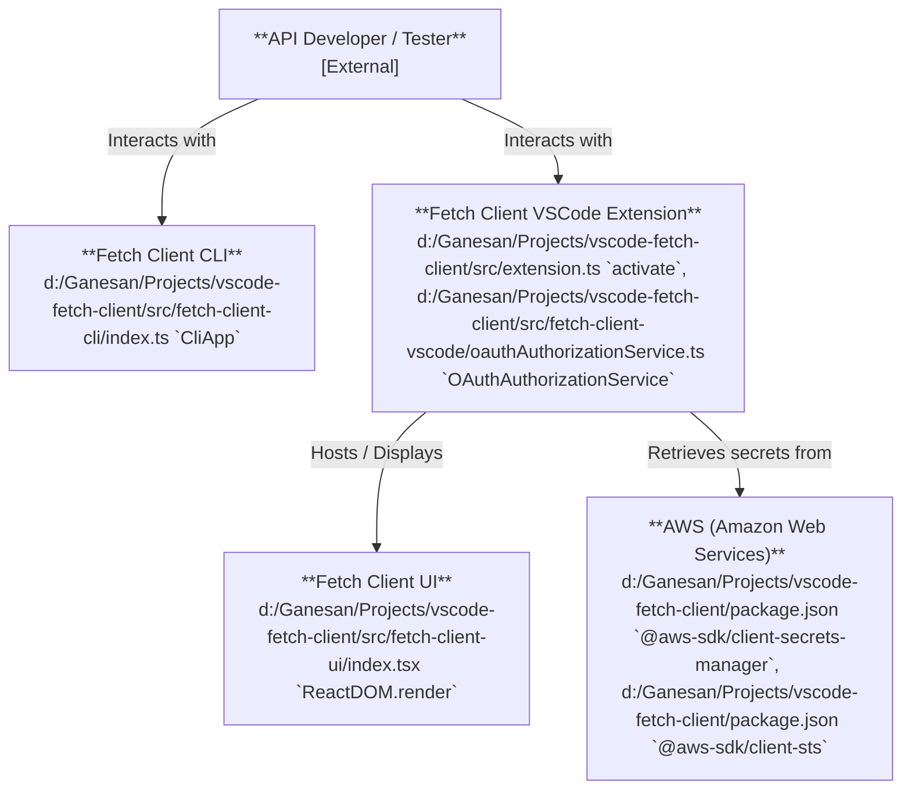
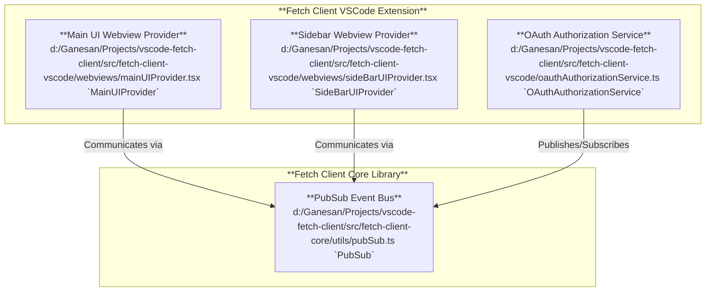

<!-- markdownlint-disable MD025 -->

# Unnamed CodeViz Diagram



# Unnamed CodeViz Diagram



# Unnamed CodeViz Diagram

```mermaid
graph TD

    vscode_extension_container.cv::fetch_client_component.cv["**Fetch Client Core Library**<br>[External]"]
    vscode_extension_container.cv::cli["**Fetch Client CLI**<br>d:/Ganesan/Projects/vscode-fetch-client/src/fetch-client-cli/index.ts `CliApp`"]
    vscode_extension_container.cv::vscode["**Fetch Client VSCode Extension**<br>d:/Ganesan/Projects/vscode-fetch-client/src/extension.ts `activate`, d:/Ganesan/Projects/vscode-fetch-client/src/fetch-client-vscode/oauthAuthorizationService.ts `OAuthAuthorizationService`"]
    vscode_extension_container.cv::aws["**AWS (Amazon Web Services)**<br>d:/Ganesan/Projects/vscode-fetch-client/package.json `@aws-sdk/client-secrets-manager`, d:/Ganesan/Projects/vscode-fetch-client/package.json `@aws-sdk/client-sts`"]
    vscode_extension_container.cv::user["**API Developer / Tester**<br>[External]"]
    vscode_extension_container.cv::base.cv["**Fetch Client CLI**<br>d:/Ganesan/Projects/vscode-fetch-client/src/fetch-client-cli/index.ts `CliApp`"]
    subgraph vscode_extension_container.cv::vscode_ext["**Fetch Client VSCode Extension**<br>[External]"]
        vscode_extension_container.cv::webapp_panel["**Web App Panel**<br>d:/Ganesan/Projects/vscode-fetch-client/src/fetch-client-vscode/webviews/WebAppPanel.ts `createOrShow`"]
        vscode_extension_container.cv::oauth_service["**OAuth Authorization Service**<br>d:/Ganesan/Projects/vscode-fetch-client/src/fetch-client-vscode/oauthAuthorizationService.ts `OAuthAuthorizationService`"]
        vscode_extension_container.cv::local_storage["**Local Storage Service**<br>d:/Ganesan/Projects/vscode-fetch-client/src/fetch-client-vscode/utils/localStorageService.ts `LocalStorageService`"]
        vscode_extension_container.cv::logger["**VSCode Logger**<br>d:/Ganesan/Projects/vscode-fetch-client/src/fetch-client-vscode/logger/vsCodeLogger.ts `VSCodeLogger`"]
        vscode_extension_container.cv::pub_sub["**PubSub Event Bus**<br>d:/Ganesan/Projects/vscode-fetch-client/src/fetch-client-core/utils/pubSub.ts `PubSub`"]
        vscode_extension_container.cv::memory_cache["**Memory Cache**<br>d:/Ganesan/Projects/vscode-fetch-client/src/fetch-client-vscode/utils/memoryCache.ts `MemoryCache`"]
        subgraph vscode_extension_container.cv::sidebar_provider["**Sidebar Provider**<br>[External]"]
            vscode_extension_container.cv::sidebar_main["**SideBarProvider**<br>d:/Ganesan/Projects/vscode-fetch-client/src/fetch-client-vscode/webviews/sideBarUIProvider.tsx `SideBarProvider`"]
            vscode_extension_container.cv::webview_html_builder["**Webview HTML Builder**<br>d:/Ganesan/Projects/vscode-fetch-client/src/fetch-client-vscode/webviews/webviewUtils.ts `buildWebviewHtml`"]
            vscode_extension_container.cv::history_db_util["**History DB Utility**<br>d:/Ganesan/Projects/vscode-fetch-client/src/fetch-client-vscode/db/historyDBUtil.ts `GetAllHistory`"]
            vscode_extension_container.cv::main_db_util["**Main DB Utility**<br>d:/Ganesan/Projects/vscode-fetch-client/src/fetch-client-vscode/db/mainDBUtil.ts `SaveRequest`"]
            vscode_extension_container.cv::var_db_util["**Variable DB Utility**<br>d:/Ganesan/Projects/vscode-fetch-client/src/fetch-client-vscode/db/varDBUtil.ts `GetAllVariable`"]
            vscode_extension_container.cv::mock_server_db_util["**Mock Server DB Utility**<br>d:/Ganesan/Projects/vscode-fetch-client/src/fetch-client-vscode/db/mockServerDBUtil.ts `GetAllMockServers`"]
            vscode_extension_container.cv::collection_db_util["**Collection DB Utility**<br>d:/Ganesan/Projects/vscode-fetch-client/src/fetch-client-vscode/db/collectionDBUtil.ts `GetAllCollections`"]
            %% Edges at this level (grouped by source)
            vscode_extension_container.cv::sidebar_main["**SideBarProvider**<br>d:/Ganesan/Projects/vscode-fetch-client/src/fetch-client-vscode/webviews/sideBarUIProvider.tsx `SideBarProvider`"] -->|"Uses to build"| vscode_extension_container.cv::webview_html_builder["**Webview HTML Builder**<br>d:/Ganesan/Projects/vscode-fetch-client/src/fetch-client-vscode/webviews/webviewUtils.ts `buildWebviewHtml`"]
            vscode_extension_container.cv::sidebar_main["**SideBarProvider**<br>d:/Ganesan/Projects/vscode-fetch-client/src/fetch-client-vscode/webviews/sideBarUIProvider.tsx `SideBarProvider`"] -->|"Manages"| vscode_extension_container.cv::history_db_util["**History DB Utility**<br>d:/Ganesan/Projects/vscode-fetch-client/src/fetch-client-vscode/db/historyDBUtil.ts `GetAllHistory`"]
            vscode_extension_container.cv::sidebar_main["**SideBarProvider**<br>d:/Ganesan/Projects/vscode-fetch-client/src/fetch-client-vscode/webviews/sideBarUIProvider.tsx `SideBarProvider`"] -->|"Manages"| vscode_extension_container.cv::main_db_util["**Main DB Utility**<br>d:/Ganesan/Projects/vscode-fetch-client/src/fetch-client-vscode/db/mainDBUtil.ts `SaveRequest`"]
            vscode_extension_container.cv::sidebar_main["**SideBarProvider**<br>d:/Ganesan/Projects/vscode-fetch-client/src/fetch-client-vscode/webviews/sideBarUIProvider.tsx `SideBarProvider`"] -->|"Manages"| vscode_extension_container.cv::var_db_util["**Variable DB Utility**<br>d:/Ganesan/Projects/vscode-fetch-client/src/fetch-client-vscode/db/varDBUtil.ts `GetAllVariable`"]
            vscode_extension_container.cv::sidebar_main["**SideBarProvider**<br>d:/Ganesan/Projects/vscode-fetch-client/src/fetch-client-vscode/webviews/sideBarUIProvider.tsx `SideBarProvider`"] -->|"Manages"| vscode_extension_container.cv::mock_server_db_util["**Mock Server DB Utility**<br>d:/Ganesan/Projects/vscode-fetch-client/src/fetch-client-vscode/db/mockServerDBUtil.ts `GetAllMockServers`"]
            vscode_extension_container.cv::sidebar_main["**SideBarProvider**<br>d:/Ganesan/Projects/vscode-fetch-client/src/fetch-client-vscode/webviews/sideBarUIProvider.tsx `SideBarProvider`"] -->|"Manages"| vscode_extension_container.cv::collection_db_util["**Collection DB Utility**<br>d:/Ganesan/Projects/vscode-fetch-client/src/fetch-client-vscode/db/collectionDBUtil.ts `GetAllCollections`"]
        end
        %% Edges at this level (grouped by source)
        vscode_extension_container.cv::sidebar_main["**SideBarProvider**<br>d:/Ganesan/Projects/vscode-fetch-client/src/fetch-client-vscode/webviews/sideBarUIProvider.tsx `SideBarProvider`"] -->|"Publishes/Subscribes"| vscode_extension_container.cv::pub_sub["**PubSub Event Bus**<br>d:/Ganesan/Projects/vscode-fetch-client/src/fetch-client-core/utils/pubSub.ts `PubSub`"]
        vscode_extension_container.cv::sidebar_main["**SideBarProvider**<br>d:/Ganesan/Projects/vscode-fetch-client/src/fetch-client-vscode/webviews/sideBarUIProvider.tsx `SideBarProvider`"] -->|"Uses"| vscode_extension_container.cv::local_storage["**Local Storage Service**<br>d:/Ganesan/Projects/vscode-fetch-client/src/fetch-client-vscode/utils/localStorageService.ts `LocalStorageService`"]
        vscode_extension_container.cv::sidebar_main["**SideBarProvider**<br>d:/Ganesan/Projects/vscode-fetch-client/src/fetch-client-vscode/webviews/sideBarUIProvider.tsx `SideBarProvider`"] -->|"Sends logs to"| vscode_extension_container.cv::logger["**VSCode Logger**<br>d:/Ganesan/Projects/vscode-fetch-client/src/fetch-client-vscode/logger/vsCodeLogger.ts `VSCodeLogger`"]
        vscode_extension_container.cv::vscode_ext["**Fetch Client VSCode Extension**<br>[External]"] -->|"Manages and embeds"| vscode_extension_container.cv::webapp_panel["**Web App Panel**<br>d:/Ganesan/Projects/vscode-fetch-client/src/fetch-client-vscode/webviews/WebAppPanel.ts `createOrShow`"]
        vscode_extension_container.cv::vscode_ext["**Fetch Client VSCode Extension**<br>[External]"] -->|"Registers and manages"| vscode_extension_container.cv::sidebar_provider["**Sidebar Provider**<br>[External]"]
        vscode_extension_container.cv::vscode_ext["**Fetch Client VSCode Extension**<br>[External]"] -->|"Uses"| vscode_extension_container.cv::oauth_service["**OAuth Authorization Service**<br>d:/Ganesan/Projects/vscode-fetch-client/src/fetch-client-vscode/oauthAuthorizationService.ts `OAuthAuthorizationService`"]
        vscode_extension_container.cv::vscode_ext["**Fetch Client VSCode Extension**<br>[External]"] -->|"Persists data to/from"| vscode_extension_container.cv::local_storage["**Local Storage Service**<br>d:/Ganesan/Projects/vscode-fetch-client/src/fetch-client-vscode/utils/localStorageService.ts `LocalStorageService`"]
        vscode_extension_container.cv::vscode_ext["**Fetch Client VSCode Extension**<br>[External]"] -->|"Sends logs to"| vscode_extension_container.cv::logger["**VSCode Logger**<br>d:/Ganesan/Projects/vscode-fetch-client/src/fetch-client-vscode/logger/vsCodeLogger.ts `VSCodeLogger`"]
        vscode_extension_container.cv::vscode_ext["**Fetch Client VSCode Extension**<br>[External]"] -->|"Publishes/Subscribes events to"| vscode_extension_container.cv::pub_sub["**PubSub Event Bus**<br>d:/Ganesan/Projects/vscode-fetch-client/src/fetch-client-core/utils/pubSub.ts `PubSub`"]
        vscode_extension_container.cv::vscode_ext["**Fetch Client VSCode Extension**<br>[External]"] -->|"Stores temporary data in"| vscode_extension_container.cv::memory_cache["**Memory Cache**<br>d:/Ganesan/Projects/vscode-fetch-client/src/fetch-client-vscode/utils/memoryCache.ts `MemoryCache`"]
        vscode_extension_container.cv::sidebar_provider["**Sidebar Provider**<br>[External]"] -->|"Opens requests in"| vscode_extension_container.cv::webapp_panel["**Web App Panel**<br>d:/Ganesan/Projects/vscode-fetch-client/src/fetch-client-vscode/webviews/WebAppPanel.ts `createOrShow`"]
        vscode_extension_container.cv::webapp_panel["**Web App Panel**<br>d:/Ganesan/Projects/vscode-fetch-client/src/fetch-client-vscode/webviews/WebAppPanel.ts `createOrShow`"] -->|"Communicates via"| vscode_extension_container.cv::pub_sub["**PubSub Event Bus**<br>d:/Ganesan/Projects/vscode-fetch-client/src/fetch-client-core/utils/pubSub.ts `PubSub`"]
    end
    subgraph vscode_extension_container.cv::ui["**Fetch Client UI**<br>[External]"]
        vscode_extension_container.cv::ui_react_app["**React Application**<br>d:/Ganesan/Projects/vscode-fetch-client/src/fetch-client-ui/index.tsx `ReactDOM.render`, d:/Ganesan/Projects/vscode-fetch-client/src/fetch-client-ui/App.tsx `App`"]
    end
    %% Edges at this level (grouped by source)
    vscode_extension_container.cv::webapp_panel["**Web App Panel**<br>d:/Ganesan/Projects/vscode-fetch-client/src/fetch-client-vscode/webviews/WebAppPanel.ts `createOrShow`"] -->|"Hosts and displays"| vscode_extension_container.cv::ui_react_app["**React Application**<br>d:/Ganesan/Projects/vscode-fetch-client/src/fetch-client-ui/index.tsx `ReactDOM.render`, d:/Ganesan/Projects/vscode-fetch-client/src/fetch-client-ui/App.tsx `App`"]
    vscode_extension_container.cv::user["**API Developer / Tester**<br>[External]"] -->|"Interacts with"| vscode_extension_container.cv::cli["**Fetch Client CLI**<br>d:/Ganesan/Projects/vscode-fetch-client/src/fetch-client-cli/index.ts `CliApp`"]
    vscode_extension_container.cv::user["**API Developer / Tester**<br>[External]"] -->|"Interacts with"| vscode_extension_container.cv::vscode["**Fetch Client VSCode Extension**<br>d:/Ganesan/Projects/vscode-fetch-client/src/extension.ts `activate`, d:/Ganesan/Projects/vscode-fetch-client/src/fetch-client-vscode/oauthAuthorizationService.ts `OAuthAuthorizationService`"]
    vscode_extension_container.cv::vscode["**Fetch Client VSCode Extension**<br>d:/Ganesan/Projects/vscode-fetch-client/src/extension.ts `activate`, d:/Ganesan/Projects/vscode-fetch-client/src/fetch-client-vscode/oauthAuthorizationService.ts `OAuthAuthorizationService`"] -->|"Hosts / Displays"| vscode_extension_container.cv::ui["**Fetch Client UI**<br>[External]"]
    vscode_extension_container.cv::vscode["**Fetch Client VSCode Extension**<br>d:/Ganesan/Projects/vscode-fetch-client/src/extension.ts `activate`, d:/Ganesan/Projects/vscode-fetch-client/src/fetch-client-vscode/oauthAuthorizationService.ts `OAuthAuthorizationService`"] -->|"Retrieves secrets from"| vscode_extension_container.cv::aws["**AWS (Amazon Web Services)**<br>d:/Ganesan/Projects/vscode-fetch-client/package.json `@aws-sdk/client-secrets-manager`, d:/Ganesan/Projects/vscode-fetch-client/package.json `@aws-sdk/client-sts`"]

```

---

_Generated by [CodeViz.ai](https://codeviz.ai) on 11/14/2026, 10:55:17 PM_
