# Fetch Client

**A VS Code API-testing extension plus a CLI that shares its local data model.**

Create or import requests, organize them into collections, execute them, inspect and test the responses, then save or export the results, from the editor or from the command line.

---

## Table of Contents

- [Features](#features)
- [Core Workflow](#core-workflow)
- [Architecture](#architecture)
  - [Diagram](#diagram)
  - [Components](#components)
  - [Connections](#connections)
- [Entry Points](#entry-points)
- [Project Structure](#project-structure)
- [Getting Started](#getting-started)
- [Contributing](#contributing)
- [License](#license)

---

## Features

| Area                       | Capability                                                                                                   |
| -------------------------- | ------------------------------------------------------------------------------------------------------------ |
| **Requests & Collections** | Create or import requests and organize them into collections                                                 |
| **Execution**              | Run requests with variable resolution and pre-request scripts                                                |
| **Response Inspection**    | View and test responses in a dedicated response panel                                                        |
| **Quality Checks**         | Quality-gate checks on API behavior                                                                          |
| **Data-driven Tests**      | Run requests against datasets                                                                                |
| **Performance Tests**      | Load and performance testing                                                                                 |
| **Mock Server**            | Start a mock server from within VS Code                                                                      |
| **Scheduling**             | Schedule requests to run automatically                                                                       |
| **Interoperability**       | Import collections from other tools and export reports/collections                                           |
| **CLI Automation**         | Run requests, checks, datasets, and load tests from the terminal, using the same local data as the extension |

---

## Core Workflow

1. **Create or import** requests.
2. **Organize** them into collections.
3. **Execute** requests.
4. **Inspect and test** responses.
5. **Save or export** results.

---

## Architecture

The extension and the CLI share one request core and one local database, so collections created in the editor are available to the CLI and vice versa.

### Diagram

```mermaid
flowchart TD

subgraph group_extension["VS Code Extension"]
  node_extension["Extension Host<br/>[extension.ts]"]
  node_webviews["Webview Providers<br/>[index.ts]"]
  node_ui["API Workspace<br/>[App.tsx]"]
  node_requestui["Request Editor<br/>[index.tsx]"]
  node_responseui["Response Viewer<br/>[index.tsx]"]
  node_messagebridge["Window Messages"]
end

subgraph group_core["Request Core"]
  node_requestmodel["Request Model<br/>[request.types.ts]"]
  node_httpengine["HTTP Execution<br/>[fetchUtil.ts]"]
  node_variables["Variable Services<br/>[variable.helper.ts]"]
  node_prefetch["Pre-request Runner<br/>[preFetchRunner.ts]"]
end

subgraph group_storage["Local Data"]
  node_collectionrepo["Collection Repository"]
  node_localdb[("Local Database<br/>[dbManager.ts]")]
end

subgraph group_cli["CLI Automation"]
  node_cli["CLI Commands<br/>[index.ts]"]
  node_importers["Collection Importers"]
  node_exporters["Collection Exporters"]
end

subgraph group_capabilities["Testing Features"]
  node_quality["Quality Checks"]
  node_datadriven["Data-driven Tests"]
  node_performance["Performance Tests<br/>[perfEngine.ts]"]
  node_mockserver["Mock Server"]
  node_scheduler["Request Scheduler<br/>[scheduler.ts]"]
end

node_user(("Developer"))

node_user -->|"uses"| node_extension
node_user -->|"runs"| node_cli
node_extension -->|"registers"| node_webviews
node_webviews -->|"hosts"| node_ui
node_ui -->|"presents"| node_requestui
node_ui -->|"presents"| node_responseui
node_requestui -->|"sends requests"| node_messagebridge
node_messagebridge -->|"bridges messages"| node_webviews
node_requestui -->|"edits"| node_requestmodel
node_extension -->|"executes requests"| node_httpengine
node_httpengine -->|"returns responses"| node_responseui
node_httpengine -.->|"resolves variables"| node_variables
node_httpengine -->|"runs pre-requests"| node_prefetch
node_collectionrepo -->|"reads and writes"| node_localdb
node_extension -->|"initializes stores"| node_localdb
node_cli -->|"uses shared data"| node_localdb
node_cli -->|"runs requests"| node_httpengine
node_cli -->|"runs checks"| node_quality
node_cli -->|"runs datasets"| node_datadriven
node_cli -->|"runs load tests"| node_performance
node_cli -->|"imports collections"| node_importers
node_cli -->|"exports reports"| node_exporters
node_extension -->|"checks API quality"| node_quality
node_extension -->|"runs data tests"| node_datadriven
node_extension -->|"runs load tests"| node_performance
node_extension -->|"starts mock server"| node_mockserver
node_extension -->|"schedules requests"| node_scheduler

classDef toneBlue fill:#dbeafe,stroke:#2563eb,stroke-width:1.5px,color:#172554
classDef toneAmber fill:#fef3c7,stroke:#d97706,stroke-width:1.5px,color:#78350f
classDef toneMint fill:#dcfce7,stroke:#16a34a,stroke-width:1.5px,color:#14532d
classDef toneRose fill:#ffe4e6,stroke:#e11d48,stroke-width:1.5px,color:#881337
classDef toneIndigo fill:#e0e7ff,stroke:#4f46e5,stroke-width:1.5px,color:#312e81
class node_extension,node_webviews,node_ui,node_requestui,node_responseui,node_messagebridge toneBlue
class node_requestmodel,node_httpengine,node_variables,node_prefetch toneAmber
class node_collectionrepo,node_localdb toneMint
class node_cli,node_importers,node_exporters toneRose
class node_quality,node_datadriven,node_performance,node_mockserver,node_scheduler,node_user toneIndigo
```



### Components

#### VS Code Extension

| Component         | Source                                                                                                                                   |
| ----------------- | ---------------------------------------------------------------------------------------------------------------------------------------- |
| Extension Host    | [`src/extension.ts`](src/extension.ts)                                                                                                   |
| Webview Providers | [`src/fetch-client-vscode/webviews/index.ts`](src/fetch-client-vscode/webviews/index.ts)                                                 |
| API Workspace     | [`src/fetch-client-ui/App.tsx`](src/fetch-client-ui/App.tsx)                                                                             |
| Request Editor    | [`src/fetch-client-ui/components/RequestUI/RequestPanel/index.tsx`](src/fetch-client-ui/components/RequestUI/RequestPanel/index.tsx)     |
| Response Viewer   | [`src/fetch-client-ui/components/ResponseUI/ResponsePanel/index.tsx`](src/fetch-client-ui/components/ResponseUI/ResponsePanel/index.tsx) |
| Window Messages   | [`src/fetch-client-ui/components/MainUI/hooks/useWindowMessages.ts`](src/fetch-client-ui/components/MainUI/hooks/useWindowMessages.ts)   |

#### Request Core

| Component          | Source                                                                                                                           |
| ------------------ | -------------------------------------------------------------------------------------------------------------------------------- |
| Request Model      | [`src/fetch-client-core/types/request.types.ts`](src/fetch-client-core/types/request.types.ts)                                   |
| HTTP Execution     | [`src/fetch-client-core/utils/fetchUtil.ts`](src/fetch-client-core/utils/fetchUtil.ts)                                           |
| Variable Services  | [`src/fetch-client-core/helpers/variable.helper.ts`](src/fetch-client-core/helpers/variable.helper.ts)                           |
| Pre-request Runner | [`src/fetch-client-core/utils/preFetchService/preFetchRunner.ts`](src/fetch-client-core/utils/preFetchService/preFetchRunner.ts) |

#### Local Data

| Component             | Source                                                                                                       |
| --------------------- | ------------------------------------------------------------------------------------------------------------ |
| Collection Repository | [`src/fetch-client-core/db/collectionDB.repository.ts`](src/fetch-client-core/db/collectionDB.repository.ts) |
| Local Database        | [`src/fetch-client-core/db/dbManager.ts`](src/fetch-client-core/db/dbManager.ts)                             |

#### CLI Automation

| Component            | Source                                                                                                       |
| -------------------- | ------------------------------------------------------------------------------------------------------------ |
| CLI Commands         | [`src/fetch-client-cli/index.ts`](src/fetch-client-cli/index.ts)                                             |
| Collection Importers | [`src/fetch-client-core/helpers/importers/collections`](src/fetch-client-core/helpers/importers/collections) |
| Collection Exporters | [`src/fetch-client-core/helpers/exporters`](src/fetch-client-core/helpers/exporters)                         |

#### Testing Features

| Component         | Source                                                                                                                                           |
| ----------------- | ------------------------------------------------------------------------------------------------------------------------------------------------ |
| Quality Checks    | [`src/fetch-client-core/helpers/qualityGate/qualityGateEngine.ts`](src/fetch-client-core/helpers/qualityGate/qualityGateEngine.ts)               |
| Data-driven Tests | [`src/fetch-client-core/utils/dataDrivenTestService/dataDrivenRunner.ts`](src/fetch-client-core/utils/dataDrivenTestService/dataDrivenRunner.ts) |
| Performance Tests | [`src/fetch-client-core/utils/performanceTestService/perfEngine.ts`](src/fetch-client-core/utils/performanceTestService/perfEngine.ts)           |
| Mock Server       | [`src/fetch-client-vscode/utils/mockServerRunner.ts`](src/fetch-client-vscode/utils/mockServerRunner.ts)                                         |
| Request Scheduler | [`src/fetch-client-vscode/utils/scheduler.ts`](src/fetch-client-vscode/utils/scheduler.ts)                                                       |

### Connections

Relationships marked **inferred** are based on README statements rather than a specific source file.

| From                  | Relationship        | To                   | Evidence                        |
| --------------------- | ------------------- | -------------------- | ------------------------------- |
| Developer             | uses                | Extension Host       | inferred                        |
| Developer             | runs                | CLI Commands         | inferred                        |
| Extension Host        | registers           | Webview Providers    | `src/extension.ts`              |
| Webview Providers     | hosts               | API Workspace        | inferred                        |
| API Workspace         | presents            | Request Editor       | `src/fetch-client-ui/App.tsx`   |
| API Workspace         | presents            | Response Viewer      | `src/fetch-client-ui/App.tsx`   |
| Request Editor        | sends requests      | Window Messages      | `useWindowMessages.ts`          |
| Window Messages       | bridges messages    | Webview Providers    | `useWindowMessages.ts`          |
| Request Editor        | edits               | Request Model        | inferred                        |
| Extension Host        | executes requests   | HTTP Execution       | inferred                        |
| HTTP Execution        | returns responses   | Response Viewer      | inferred                        |
| HTTP Execution        | resolves variables  | Variable Services    | inferred                        |
| HTTP Execution        | runs pre-requests   | Pre-request Runner   | inferred                        |
| Collection Repository | reads and writes    | Local Database       | `collectionDB.repository.ts`    |
| Extension Host        | initializes stores  | Local Database       | `src/extension.ts`              |
| CLI Commands          | uses shared data    | Local Database       | inferred                        |
| CLI Commands          | runs requests       | HTTP Execution       | inferred                        |
| CLI Commands          | runs checks         | Quality Checks       | `src/fetch-client-cli/index.ts` |
| CLI Commands          | runs datasets       | Data-driven Tests    | inferred                        |
| CLI Commands          | runs load tests     | Performance Tests    | `src/fetch-client-cli/index.ts` |
| CLI Commands          | imports collections | Collection Importers | inferred                        |
| CLI Commands          | exports reports     | Collection Exporters | inferred                        |
| Extension Host        | checks API quality  | Quality Checks       | inferred                        |
| Extension Host        | runs data tests     | Data-driven Tests    | inferred                        |
| Extension Host        | runs load tests     | Performance Tests    | inferred                        |
| Extension Host        | starts mock server  | Mock Server          | `src/extension.ts`              |
| Extension Host        | schedules requests  | Request Scheduler    | `src/extension.ts`              |

---

## Entry Points

| Entry point    | File                                                                                   | Purpose                                                                                                       |
| -------------- | -------------------------------------------------------------------------------------- | ------------------------------------------------------------------------------------------------------------- |
| Extension Host | [`src/extension.ts`](src/extension.ts)                                                 | Activates the VS Code extension, registers webviews, initializes stores, starts the mock server and scheduler |
| CLI Commands   | [`src/fetch-client-cli/index.ts`](src/fetch-client-cli/index.ts)                       | Terminal interface for running requests, checks, datasets, and load tests                                     |
| HTTP Execution | [`src/fetch-client-core/utils/fetchUtil.ts`](src/fetch-client-core/utils/fetchUtil.ts) | Shared request execution engine                                                                               |
| API Workspace  | [`src/fetch-client-ui/App.tsx`](src/fetch-client-ui/App.tsx)                           | Root of the webview UI                                                                                        |

---

## Project Structure

```text
src/
├── extension.ts                  # Extension Host entry point
├── fetch-client-vscode/          # VS Code–specific code
│   ├── webviews/                 # Webview providers
│   └── utils/                    # Mock server runner, scheduler
├── fetch-client-ui/              # React webview UI
│   ├── App.tsx                   # API Workspace
│   └── components/
│       ├── RequestUI/            # Request Editor
│       ├── ResponseUI/           # Response Viewer
│       └── MainUI/hooks/         # Window message bridge
├── fetch-client-core/            # Shared core (extension + CLI)
│   ├── types/                    # Request model
│   ├── utils/                    # HTTP execution, pre-request, data-driven, performance
│   ├── helpers/                  # Variables, importers, exporters, quality gate
│   └── db/                       # Local database and repositories
└── fetch-client-cli/             # CLI entry point
```

---

## Getting Started

> Add installation details for your release channel here.

**Extension**

1. Install **Fetch Client** from the VS Code Marketplace.
2. Open the Fetch Client view and create or import a request.
3. Group requests into collections, send them, and inspect the response.

**CLI**

The CLI reads the same local database as the extension, so collections you build in VS Code can be run from the terminal.

```bash
# TODO: replace with the actual install and usage commands
```

---

## Contributing

Contributions are welcome. Please open an issue to discuss significant changes before submitting a pull request.

## License

See the repository's `LICENSE` file.

---

## Notes on This Document

Relationships for subsystems not directly sampled are based on documented README statements. Source-level links are limited to relationships visible in the supplied excerpts or source index.
